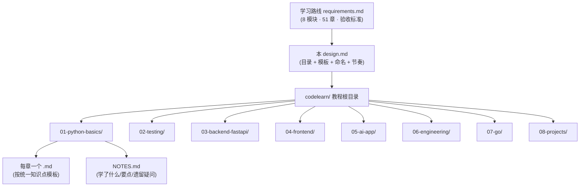
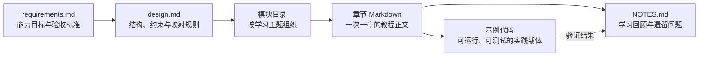
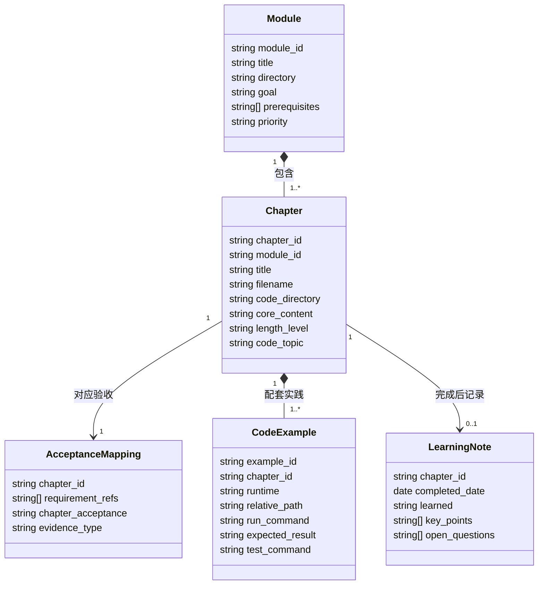
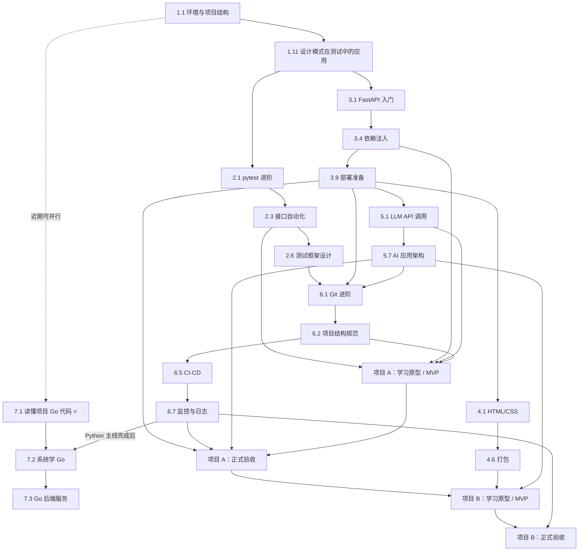
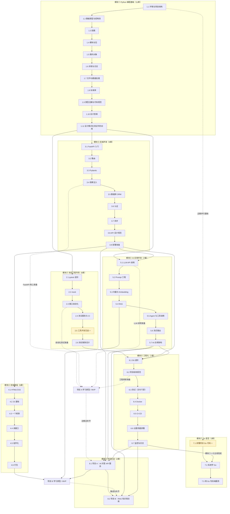

# Design Document

## Overview

这份 design **不是软件架构设计，而是一份「学习教程文档的结构设计（文档工程 design）」**。

它要回答的问题是：把 `requirements.md` 里那条「从测试工程师转型 AI 全栈工程师」的学习路线，落成一套**可读、可练、可验收**的教程文档时——

- 应该由**哪些章节文件**组成？
- 每章**写什么、写多长、配什么代码示例、对应哪条验收标准**？
- 这些章节**按什么先后依赖**推进？哪些是「近期优先」？
- 每一章正文按**什么统一模板**写？
- 文件**怎么拆、放哪里、怎么命名**？
- 3~6 个月的**文档产出节奏**怎么安排？

设计输入是 `requirements.md` 的 8 个模块（①~⑧）及其各章节要点与验收标准。设计输出是「一套教程文档的骨架规范」——后续每写一章，都严格遵循本文件定义的目录、模板与命名约定。

### 设计原则（贯穿全篇）

| 原则 | 含义 | 来源 |
|------|------|------|
| 验收驱动 | 每章都绑定 `requirements.md` 里一条可判断"过/不过"的验收标准，教程写完能对照检查 | Requirement 全篇 |
| 场景先行 | 每个知识点从测试工作 / AI 应用的真实问题切入，不做"简介/概述"式空话 | learning-style「禁止」 |
| 讲"为什么" | 先讲设计动机与取舍，再讲怎么写 | Req 22.3、learning-style |
| 可运行 | 代码示例标注 Python 3.12+ / Go 1.22+，可直接跑出预期结果 | Req 22.1 |
| 复用测试思维 | 每章尽量配套测试 / 边界思考，把学习者的存量优势变现 | Req 22.4 |
| 一次一章 | 文档按章产出，写完停下等确认，避免超长文档 | learning-style |

---

## Architecture

### 文档整体架构

整套教程是一个三层结构：**模块（Module）→ 章节（Chapter）→ 文件（.md）**，外加每个模块目录一份 `NOTES.md` 做回顾沉淀。



- **模块层**：对应 `requirements.md` 的 8 个模块，一个模块 = `codelearn/` 下一个子目录。
- **章节层**：对应各模块下的二级标题（章节要点），一个章节 = 目录里一个 `.md` 文件。
- **文件层**：每个 `.md` 严格套用「统一知识点模板」。
- **沉淀层**：每个模块目录一份 `NOTES.md`，随学随记（对齐 Req 21.5 与 steering）。

全套共 **8 个模块、51 个章节文件、8 份 NOTES.md**。

---

## Components and Interfaces

### 文档组件及职责

这套文档工程以文件和目录作为组件边界，形成单向产出链：



| 组件 | 输入 | 核心职责 | 章级产出接口 |
|------|------|----------|--------------|
| `requirements.md` | 学习目标、能力差距、阶段约束 | 定义「学什么」以及可判断过/不过的验收标准 | 向 `design.md` 提供 Requirement 编号、章节要点和验收语句 |
| `design.md` | 已确认的 requirements 与工作区学习规范 | 定义目录、章节元信息、依赖、模板、命名和质量门禁 | 向每章提供唯一文件名、核心内容、篇幅、代码主题与验收映射 |
| 模块目录 | 设计中的模块划分 | 聚合同一主题下的章节、代码与笔记，保持边界清晰 | 每个模块输出若干章节 `.md`、可选 `code/` 和一份 `NOTES.md` |
| 章节 Markdown | 章节元信息、统一模板、对应验收 | 交付一次完整学习单元，解释为什么、展示怎么做并提供练习 | 必须保留目录并按七个核心正文部分输出；章头声明环境和精确验收映射；引用示例代码相对路径 |
| 示例代码 | 章节中的实践场景与运行环境 | 提供可直接运行、可测试的客观学习证据 | 输出明确运行命令、预期结果；较大示例放入模块 `code/` 子目录 |
| `NOTES.md` | 章节学习结果、代码验证结果、自检答案 | 沉淀已学内容、关键要点和遗留疑问 | 每完成一章追加一条固定三段式记录，不覆盖历史记录 |

### 章级产出接口约定

一个章节只有同时交付以下接口，才视为完成：

1. **文档接口**：一个符合命名规范的 `.md` 文件，完整包含统一知识点模板要求的段落。
2. **验收接口**：章头和练习题明确指向 `requirements.md` 中的章节验收或 Requirement 编号。
3. **运行接口**：示例给出运行环境、命令与预期结果；较大工程通过相对路径与正文连接。
4. **回顾接口**：对应模块的 `NOTES.md` 追加「学了什么 / 关键要点 / 遗留疑问」。

组件之间保持单向依赖：需求约束设计，设计约束模块与章节，章节引用代码并产生学习笔记；下游产物不得反向改写上游已确认方案。

---

## Data Models

这里的“数据模型”描述 Markdown 文档、目录和映射记录之间的结构关系，**不是数据库表设计，也不要求实现 ORM**。

### 核心模型

| 模型 | 关键字段 | 含义与约束 |
|------|----------|------------|
| `Module` | `module_id`、`title`、`directory`、`goal`、`prerequisites`、`priority` | 对应 8 个学习模块；`module_id` 与目录两位编号唯一；可声明前置模块和近期优先级 |
| `Chapter` | `chapter_id`、`module_id`、`title`、`filename`、`code_directory`、`core_content`、`length_level`、`code_topic` | 对应 51 个章节；隶属且仅隶属一个 Module；文件名在模块目录内唯一；`code_directory` 必须为 `code/{Markdown 文件 stem}/` |
| `AcceptanceMapping` | `chapter_id`、`requirement_refs`、`chapter_acceptance`、`evidence_type` | 连接章节与验收标准；记录顶层 Requirement 引用、章节级验收语句及证据形式（代码、练习、报告或讲解） |
| `CodeExample` | `example_id`、`chapter_id`、`runtime`、`relative_path`、`run_command`、`expected_result`、`test_command` | 一个章节可有一个或多个示例；默认位于该章 `code/{Markdown 文件 stem}/`；多个独立示例使用章目录下 `{NN}-{example-slug}/`；必须声明 Python 3.12+ 或 Go 1.22+，并提供可复现的运行证据 |
| `LearningNote` | `chapter_id`、`completed_date`、`learned`、`key_points`、`open_questions` | 每完成一个知识点追加到模块 `NOTES.md`；保留学习轨迹和待深入问题 |

### 模型关系



关系约束：
- 每个 `Chapter` 必须属于唯一 `Module`，并拥有唯一 `AcceptanceMapping`；若提供配套代码，`code_directory` 必须与章节 Markdown 文件 stem 一致。
- 每个章节至少提供一个 `CodeExample`；纯架构型章节也应提供可检查的图、配置或最小骨架作为实践证据。多个独立示例只能放在该章代码目录内的编号子目录中，不得直接散落为 `code/` 下与章节无关的一级目录。
- `LearningNote` 在章节完成后产生，因此设计阶段允许为 `0`，完成后必须为 `1`。
- 章节依赖由 `Module.prerequisites` 与第 3 节章节依赖图共同约束，不允许下游章节被安排到其必需前置章节之前。

---

### 跨模块重复主题的递进边界

部分主题会在基础模块与工程化模块再次出现。后续章节不是重复讲一遍基础 API，而是在复用前章产物的基础上，提高交付范围、运行环境和验收强度。

| 主题链路 | 前章边界 | 后章边界 | 复用关系与升级点 |
|----------|----------|----------|------------------|
| 1.1 环境与项目结构 → 6.2 项目结构规范 | 面向单人练习的 Python 基础骨架：虚拟环境、依赖声明、`src/` 与 `tests/` 布局，目标是项目能运行、能测试 | 面向团队和部署的可交付工程规范：分层目录、配置分离、依赖锁定、README、协作与发布约定 | 6.2 直接接收 1.1 的项目骨架，不重复讲 venv 等基础命令；重点把“能运行”升级为“可协作、可部署、可维护” |
| 2.4 测试报告与 CI → 6.5 CI-CD | 聚焦测试执行链：触发测试、生成和保存报告、让失败结果可见 | 聚焦完整交付流水线：测试门禁、构建制品、镜像发布、部署与回滚雏形 | 6.5 复用 2.4 已能运行的测试命令和报告产物，不重复 pytest/报告插件用法；重点加入构建与部署阶段 |
| 1.6 异常与日志 → 6.7 监控与日志 | 聚焦应用内编码：异常边界、自定义异常、日志级别与上下文 | 聚焦线上可观测性：结构化采集、检索关联、告警、结合请求链路定位线上问题 | 6.7 复用 1.6 已产生的应用日志，不重复 `logging` 基础 API；重点验证日志进入运行环境后是否可查询、可关联、可用于定位 |

递进执行规则：前章产物应成为后章练习的输入；如果后章发现基础能力不达标，应回到对应前章补齐，而不是在后章正文中复制基础教程。

---

## 1. 完整章节目录（到二级标题）

下面把 8 个模块的全部章节要点，逐条列成教程章节目录。编号规则：`模块号.章号`。

### 模块① Python 编程基础（01）
- 1.1 环境与项目结构
- 1.2 数据类型与控制流
- 1.3 函数
- 1.4 模块与包
- 1.5 面向对象
- 1.6 异常与日志
- 1.7 文件与数据处理
- 1.8 标准库
- 1.9 类型注解与代码规范
- 1.10 设计思维（分层/抽象/解耦）
- 1.11 设计模式在测试中的应用

### 模块② 测试工程专项（02）
- 2.1 pytest 进阶
- 2.2 mock
- 2.3 接口自动化
- 2.4 测试报告与 CI
- 2.5 工具开发实战
- 2.6 测试框架设计

### 模块③ 后端开发（03）
- 3.1 FastAPI 入门
- 3.2 路由
- 3.3 Pydantic
- 3.4 依赖注入
- 3.5 数据库 ORM
- 3.6 认证
- 3.7 异步
- 3.8 API 设计规范
- 3.9 部署准备

### 模块④ 前端基础（04）
- 4.1 HTML/CSS
- 4.2 JS 基础
- 4.3 一个框架（Vue / React 二选一）
- 4.4 调接口
- 4.5 组件化
- 4.6 打包

### 模块⑤ AI 应用开发（05）
- 5.1 LLM API 调用
- 5.2 Prompt 工程
- 5.3 向量与 Embedding
- 5.4 RAG
- 5.5 Agent 与工具调用
- 5.6 流式输出
- 5.7 AI 应用架构

### 模块⑥ 工程化（06）
- 6.1 Git 进阶
- 6.2 项目结构规范
- 6.3 测试（纳入交付门禁）
- 6.4 Docker
- 6.5 CI-CD
- 6.6 云服务器部署
- 6.7 监控与日志

### 模块⑦ Go 语言（07）
- 7.1 阶段1：读懂项目 Go 代码
- 7.2 阶段2：系统学 Go
- 7.3 阶段3：用 Go 写一个后端服务

### 模块⑧ 项目实战（08）
- 8.1 项目 A（中期）：AI 问答 API 服务
- 8.2 项目 B（后期）：带前端的 RAG 知识库应用

---

## 2. 每章元信息表

### 验收引用规则

元信息表中的验收标识必须按以下规则解释和沿用：

- `Req X.Y`：精确指向 `requirements.md` 中顶层 Requirement X 的第 Y 条 Acceptance Criterion，例如 `Req 1.1` 指 Requirement 1 的第 1 条验收标准。
- `Req X`：仅表示该章服务于整个顶层能力范围，是兼容现有元信息的范围标识，不能单独作为“通过”判据；正式验收时必须继续回查该 Requirement 的适用 Acceptance Criteria。
- `模块N·章节名`：精确指向 `requirements.md` 对应模块、对应章节标题下的“验收”语句，例如 `模块②·mock` 指模块②“mock”章节下的验收语句。
- 当同一行同时列出两类标识时，表示**两项验收均须满足**，不能以其中一项替代另一项；仅完成章节练习但未达到顶层能力标准，不视为完整达标。
- 后续生成的 `tasks.md`（仅在用户进入任务阶段后）以及每章章头，必须原样引用元信息表中的这些标识；任务和章节不得把验收条件弱化为“学会”“了解”或“理解”等不可判定表述。

本设计不重复抄写 51 条验收全文；执行和评审时以这些稳定标识回查 `requirements.md` 原文，确保单一事实来源。

篇幅约定：**短** ≈ 800~1500 字，**中** ≈ 1500~3000 字，**长** ≈ 3000~5000 字。“验收/对应 Req”列引用 `requirements.md` 中该章验收标准或顶层 Requirement 编号。

### 模块① Python 编程基础

| 章节 | 核心内容 | 篇幅 | 代码示例主题 | 验收 / 对应 Req |
|------|----------|------|--------------|-----------------|
| 1.1 环境与项目结构 | venv、pyproject.toml、src/tests 布局 | 中 | 从零搭一个可运行项目骨架 | 模块①·环境；Req 1.1 |
| 1.2 数据类型与控制流 | list/dict/set、条件循环、推导式 | 中 | 清洗一批测试数据 | 模块①·数据类型；Req 1 |
| 1.3 函数 | 参数/返回值/作用域、职责单一 | 中 | 把重复断言逻辑抽成函数 | 模块①·函数；Req 1.2 |
| 1.4 模块与包 | import 机制、模块拆分、包组织 | 中 | 拆分一个超单文件的脚本 | 模块①·模块与包 |
| 1.5 面向对象 | 类/封装/继承/组合、何时用 OOP | 长 | 用类建模一个测试用例集 | 模块①·面向对象 |
| 1.6 异常与日志 | try/except、自定义异常、logging | 中 | 脚本异常输入的容错与日志 | 模块①·异常；Req 2.2 |
| 1.7 文件与数据处理 | 文本/CSV/JSON 读写、数据清洗 | 中 | 读 CSV 转 JSON 报告 | 模块①·文件；Req 1 |
| 1.8 标准库 | os/pathlib/datetime/collections/itertools | 中 | 用标准库替代手写轮子 | 模块①·标准库 |
| 1.9 类型注解与代码规范 | type hints、lint/format、命名 | 短 | 给函数补注解并过 lint | 模块①·类型注解；Req 1.2 |
| 1.10 设计思维（分层/抽象/解耦） | 分层、抽象边界、依赖解耦 | 长 | 把面条脚本重构成分层结构 | 模块①·设计思维；Req 1.5 |
| 1.11 设计模式在测试中的应用 | 工厂/策略/装饰器在测试代码落地 | 长 | 用策略模式消除测试重复 | 模块①·设计模式；Req 22.5 |

### 模块② 测试工程专项

| 章节 | 核心内容 | 篇幅 | 代码示例主题 | 验收 / 对应 Req |
|------|----------|------|--------------|-----------------|
| 2.1 pytest 进阶 | fixture、参数化、conftest、标记 | 中 | 用参数化消除相似用例 | 模块②·pytest；Req 1.3 |
| 2.2 mock | mock/patch、隔离外部依赖 | 中 | mock 掉 HTTP/时间依赖 | 模块②·mock；Req 1.4 |
| 2.3 接口自动化 | HTTP 请求、断言、用例组织 | 中 | 覆盖正常+边界的接口用例 | 模块②·接口自动化；Req 4.5 |
| 2.4 测试报告与 CI | 报告生成、在 CI 跑测试 | 短 | 生成 HTML 报告 + CI 触发 | 模块②·报告；Req 8.2 |
| 2.5 工具开发实战 ⭐ | 把测试需求做成可复用工具 | 长 | 交付一个实际可用的测试工具 | 模块②·工具；Req 2（近期优先） |
| 2.6 测试框架设计 | 分层框架、配置、可扩展性 | 长 | 设计可扩展测试框架骨架 | 模块②·框架；Req 22.5 |

### 模块③ 后端开发

| 章节 | 核心内容 | 篇幅 | 代码示例主题 | 验收 / 对应 Req |
|------|----------|------|--------------|-----------------|
| 3.1 FastAPI 入门 | ASGI、应用实例、Swagger 文档 | 中 | 启动应用并看自动接口文档 | 模块③·入门；Req 4 |
| 3.2 路由 | 路径操作、方法、路径/查询参数、请求体 | 中 | 实现一组 CRUD 路由 | 模块③·路由；Req 4.1 |
| 3.3 Pydantic | 模型定义、校验、请求/响应模型分离 | 中 | 定义并自动校验输入输出模型 | 模块③·Pydantic；Req 4.1 |
| 3.4 依赖注入 | Depends、共享依赖、会话注入、可测性 | 中 | 用 Depends 复用 DB 会话 | 模块③·依赖注入；Req 1.4 |
| 3.5 数据库 ORM | SQLAlchemy 建模、会话、CRUD、迁移 | 长 | ORM 完成建模与增删改查 | 模块③·ORM；Req 4.2 |
| 3.6 认证 | token/JWT、密码哈希、依赖式鉴权 | 长 | 实现 token 校验并拒未授权 | 模块③·认证；Req 4.3 |
| 3.7 异步 | async/await、异步路由、何时用异步 | 中 | 异步处理耗时操作不阻塞 | 模块③·异步；Req 4.4 |
| 3.8 API 设计规范 | RESTful 命名、状态码、统一错误结构、版本 | 中 | 设计一致的错误响应结构 | 模块③·API 设计；Req 4 |
| 3.9 部署准备 | 配置/环境变量分离、uvicorn/gunicorn、容器衔接 | 短 | 让后端可容器化启动 | 模块③·部署准备；Req 7 |

### 模块④ 前端基础

| 章节 | 核心内容 | 篇幅 | 代码示例主题 | 验收 / 对应 Req |
|------|----------|------|--------------|-----------------|
| 4.1 HTML/CSS | 语义化标签、盒模型、Flex/Grid、响应式 | 中 | 一个结构清晰的列表页 | 模块④·HTML/CSS；Req 5.1 |
| 4.2 JS 基础 | 变量/函数、DOM、事件、fetch/Promise | 中 | 用 JS 处理事件与异步数据 | 模块④·JS；Req 5 |
| 4.3 一个框架 | 组件、状态、数据驱动视图（Vue/React 二选一） | 长 | 用框架实现组件化页面 | 模块④·框架；Req 5.1 |
| 4.4 调接口 | fetch/axios、异步、CORS、数据绑定 | 中 | 调后端 API 并渲染结果 | 模块④·调接口；Req 5.2 |
| 4.5 组件化 | 组件拆分、props/事件通信、复用组合 | 中 | 抽取可复用组件 | 模块④·组件化；Req 5 |
| 4.6 打包 | Vite、打包产物、静态资源部署 | 短 | 打包为可部署静态产物 | 模块④·打包；Req 5.4 |

### 模块⑤ AI 应用开发

| 章节 | 核心内容 | 篇幅 | 代码示例主题 | 验收 / 对应 Req |
|------|----------|------|--------------|-----------------|
| 5.1 LLM API 调用 | 客户端调用、messages、参数、错误重试 | 中 | 完成一次问答并处理错误 | 模块⑤·LLM 调用；Req 6.1 |
| 5.2 Prompt 工程 | 角色设定、few-shot、结构化输出、调优 | 中 | 迭代 Prompt 改善输出 | 模块⑤·Prompt；Req 6 |
| 5.3 向量与 Embedding | 文本向量化、余弦相似度、向量库基础 | 中 | 文本转向量并算相似度 | 模块⑤·向量；Req 6.2 |
| 5.4 RAG | 切分→向量化→检索→生成 完整流程 | 长 | 跑通一个最小 RAG demo | 模块⑤·RAG；Req 6.2 |
| 5.5 Agent 与工具调用 | function calling、工具定义、多步决策 | 长 | 让 LLM 选工具的简单 Agent | 模块⑤·Agent；Req 6.3 |
| 5.6 流式输出 | SSE/流式响应、逐 token、前端增量渲染 | 中 | 实现流式返回 | 模块⑤·流式；Req 6.4 |
| 5.7 AI 应用架构 | 分层(接入/编排/模型/数据)、数据流、成本延迟取舍 | 长 | 画出 AI 应用分层架构 | 模块⑤·架构；Req 6.5 |

### 模块⑥ 工程化

| 章节 | 核心内容 | 篇幅 | 代码示例主题 | 验收 / 对应 Req |
|------|----------|------|--------------|-----------------|
| 6.1 Git 进阶 | 分支模型、merge/rebase、冲突、PR 流程 | 中 | 分支合并并解决一次冲突 | 模块⑥·Git；Req 8.1 |
| 6.2 项目结构规范 | 分层目录、配置管理、依赖锁定、README | 短 | 组织一个可维护项目结构 | 模块⑥·项目结构；Req 8.3 |
| 6.3 测试（交付门禁） | 自动化测试入流程、覆盖率、门禁 | 短 | 把测试设为交付门禁 | 模块⑥·测试；Req 8.2 |
| 6.4 Docker | 镜像/容器、Dockerfile、分层缓存、Compose | 长 | 写 Dockerfile 构建镜像 | 模块⑥·Docker；Req 7.1、7.2 |
| 6.5 CI-CD | 流水线、自动测试、自动构建部署雏形 | 中 | 提交触发 CI 跑测试 | 模块⑥·CI-CD；Req 8.2 |
| 6.6 云服务器部署 | 服务器基础、Nginx 反代、公网访问、HTTPS | 中 | 部署到云服务器公网可访问 | 模块⑥·部署；Req 7.3 |
| 6.7 监控与日志 | 结构化日志、日志查看、错误定位、基础监控 | 短 | 查日志定位一次线上错误 | 模块⑥·监控；Req 7.4 |

### 模块⑦ Go 语言

| 章节 | 核心内容 | 篇幅 | 代码示例主题 | 验收 / 对应 Req |
|------|----------|------|--------------|-----------------|
| 7.1 读懂项目 Go 代码 ⭐ | 语法速览、goroutine/channel、常见项目模式 | 长 | 逐段读懂 handler/并发代码 | 模块⑦·阶段1；Req 3、9（近期优先） |
| 7.2 系统学 Go | 语法体系、并发模型、工程化（模块/测试/依赖） | 长 | 写一个带测试的 Go 小程序 | 模块⑦·阶段2；Req 10 |
| 7.3 用 Go 写后端服务 | HTTP 服务、并发处理、工程结构 | 长 | 用 Go 实现 HTTP 接口服务 | 模块⑦·阶段3；Req 10.2、10.3 |

### 模块⑧ 项目实战

| 章节 | 核心内容 | 篇幅 | 代码示例主题 | 验收 / 对应 Req |
|------|----------|------|--------------|-----------------|
| 8.1 项目 A：AI 问答 API 服务 | 后端 API + LLM 调用 + 自动化测试 + 可容器化 | 长 | 端到端搭一个可部署问答服务 | 模块⑧·项目A；Req 11.1 |
| 8.2 项目 B：RAG 知识库应用 | 前端 + 后端 + RAG + 部署，公网可访问 | 长 | 端到端搭一个 RAG 应用 | 模块⑧·项目B；Req 11.2 |

> ⭐ 标记为「近期优先」章节：2.5 工具开发实战、7.1 读懂项目 Go 代码。

---

## 3. 章节依赖关系（Mermaid）

依赖设计分为两层：模块级总图用于快速判断主线和项目门槛；章节级全图用于实际排课与验收。两张图的跨模块边均落在具体章节节点上，不连接 `subgraph` ID。

### 3.1 模块级总图（以具体首尾章节表达）



> 总图只展示模块首尾和关键门槛，不替代下面的 51 章全图。工程化 6.1~6.7 可使用测试、后端和 AI 产物先行完成；前端静态产物在项目 B 阶段复用既有 CI-CD 与部署能力接入，不把模块④设为项目 A 的隐含前置。

### 3.2 章节级全图（覆盖全部 51 章）

模块内默认按编号递进，保证每个章节节点均有明确前序或后续；跨模块依赖只连接具体章节。虚线表示可以并行准备或提前做学习原型，不表示已满足正式验收。



覆盖说明：图中包含模块① 11 章、② 6 章、③ 9 章、④ 6 章、⑤ 7 章、⑥ 7 章、⑦ 3 章、⑧ 2 章，共 **51 个正式章节节点**；`AM`、`BM` 是阶段门槛节点，不计入章节数。1.2、1.4、1.6、1.7、1.8、1.9、2.4 等此前遗漏或悬空的章节均已纳入模块内顺序链。

关键执行规则：
- 模块①仍是一切正式主线的地基；模块②、③从 1.11 后进入，模块⑤同时受 Python 基础与 FastAPI 后端能力约束。
- 模块⑥按章节渐进：测试、后端、AI 产物进入 6.1~6.7，先形成项目 A 所需的容器、流水线、部署和监控能力；模块④的前端产物在项目 B 阶段复用这些能力接入，不重复学习工程化基础，也不让前端成为项目 A 的隐含前置。
- 7.1 只需少量基础语法即可作为近期任务并行；7.2 同时依赖 7.1 与模块①~⑥主线完成，7.3 只能在 7.2 后开始。
- 虚线到 `AM` / `BM` 只表示可开始原型探索；到 8.1 / 8.2 的实线表示正式验收门槛，不得将原型完成等同于 Requirement 11 达标。

### 3.3 项目准备阶段与准入门槛

“开始做 MVP”与“达到 Requirement 11 的正式验收”是两个不同状态。MVP 用于尽早暴露集成问题，允许边做边补齐；正式验收必须满足 `requirements.md` 的全部对应标准，不因时间紧张而降级。

| 项目 | 可开始 MVP 的前置章节 | 正式验收前必须完成的章节 / 能力 | 准备产物 |
|------|----------------------|----------------------------------|----------|
| 项目 A：AI 问答 API 服务 | 2.1~2.3（可执行测试与接口自动化）、3.1~3.4（FastAPI 路由/模型/依赖注入核心）、5.1（LLM API 调用）、6.2（可交付项目骨架）；3.8 的 API 规范建议在首次对外联调前补齐 | 按 Req 20.4 完成模块③、⑤、⑥；至少实证 FastAPI API、真实或可替换的 LLM 调用、自动化测试、Docker 构建/启动、部署可访问、日志定位，以及架构与取舍讲解，满足 Req 11.1、11.3、11.4 | API 契约草案、最小路由与请求/响应模型、可替换的 LLM 客户端、首批自动化测试、项目 README 与 Docker 化清单 |
| 项目 B：带前端的 RAG 知识库应用 | 项目 A 已正式验收；模块④ 4.1~4.6 已完成；5.4 RAG 流程已能独立运行。满足后可把既有后端、RAG demo 与前端静态产物组合成 MVP | 完成前端/后端/RAG 全链路，复用并针对多服务重新应用 5.7 架构设计及 6.5~6.7 的 CI-CD、云部署、监控日志能力；自动化测试通过且公网可访问，满足 Req 11.2、11.3、11.4 | 已验收的项目 A 基线、前端构建产物、可复现的 RAG 检索样例与评估问题集、部署拓扑、监控与故障定位清单 |

准入执行约定：
1. **原型可提前，验收不提前。** `AM` 可在核心章节完成后开始；项目 A 只有跨过模块③⑤⑥与 Requirement 11 的正式门槛，才记为 8.1 完成。
2. **项目 B 不绕过项目 A。** 只有项目 A 正式验收且模块④完成后，才进入项目 B 的 MVP 集成；这与 Req 20.4 保持一致。
3. **边做边补齐必须可追踪。** MVP 阶段发现的缺口记录到项目检查清单，并在正式验收前逐项关闭；不得用“原型能跑”替代自动化测试、部署、监控或架构讲解。

---

## 4. 统一「知识点模板」（写每章正文必须遵守）

**这是本设计对后续所有章节正文的强制规范**，与 `steering/learning-style.md` 的「文档风格」完全对齐。每个章节 `.md` 必须保留目录，并按以下七个核心正文部分组织，缺一不可。

```markdown
# {模块号}.{章号} {章节标题}

> 运行环境：Python 3.12+ / Go 1.22+
>
> 对应模块验收：{模块N·章节名}

**Validates: Requirements X.Y, X.Z**

## 目录
- [1. 场景引入](#1-场景引入)
- [2. 可运行代码示例](#2-可运行代码示例)
- [3. 设计思考](#3-设计思考)
- [4. 常见坑](#4-常见坑)
- [5. 最佳实践](#5-最佳实践)
- [6. 练习题](#6-练习题)
- [7. 小结与自检](#7-小结与自检)

## 1. 场景引入
- 从测试工作 / AI 应用中的一个**真实问题**切入
- 一句话直觉解释这个知识点“解决了什么痛点”
- 禁止“简介/概述”式空话

## 2. 可运行代码示例
- 完整、可直接运行的代码，标注运行环境
- 关键行配注释，说明每一步在做什么
- 鼓励读者先预测输出，再实际运行对照（Req 22.6）

## 3. 设计思考
- 为什么这么写？背后的原理是什么？
- 涉及取舍时列常见方案的优缺点 + 适用场景（Req 22.5）
- 这段代码是否可优化？在什么规模下需要重构？

## 4. 常见坑
- 用表格列“坑 → 后果 → 根本原因”
- 结合测试思维分析边界条件、异常输入和易错点

## 5. 最佳实践
- 针对上一节每类问题给出可执行的正确做法
- 说明实践的适用范围，避免把场景化建议绝对化

## 6. 练习题
- 1~3 题，尽量来自真实场景（测试工作 / AI 应用）
- 每题标注难度与对应验收标识，便于自我验收

## 7. 小结与自检
- 3~5 条要点回顾
- 抛 1~2 个检验理解的小问题（读者可选择跳过）
```

模板使用约束：
- **目录始终保留**：所有章节都必须有目录；短章可只有少量条目，但不得省略目录。
- **验收标识精确**：章头必须原样引用元信息表中的模块验收标识，并保留独立的 `**Validates: Requirements X.Y, X.Z**` 行。
- **代码优先可运行**：示例贴进对应 `codelearn/` 子目录即可跑，不留 `...` 占位。
- **每章至少一处“为什么”**：不得只讲 API 用法（learning-style「禁止」）。
- **不做大段语言对比**：Go 与 Python 只在“必要时的简短对照”处点一句。
- **篇幅受控**：一次只写一章，不堆超长文档；超“长”篇幅的章节可在文件内用二级标题分节，但仍是一个文件。

---

## 5. 输出方式规划

### 方案决策：每章一个文件（chapter-per-file），按模块建子目录

**选定方案**：每个**章节**对应一个独立 `.md` 文件，同一模块的章节文件放进同一个子目录；每个模块子目录额外放一份 `NOTES.md`。

**为什么选每章一个文件（而不是每模块一个文件）**：

| 对比维度 | 每章一个文件（✅选用） | 每模块一个文件 |
|----------|----------------------|----------------|
| 与"一次一章"产出节奏 | 天然契合，一个文件=一次交付 | 需反复追加同一大文件，易冲突 |
| 单文件长度 | 每个文件短小可读 | 模块①有 11 章，单文件会超长 |
| 对应验收 | 一个文件对应一条可验收里程碑 | 验收颗粒度模糊 |
| 复习检索 | 按章名直接定位 | 需在长文里翻找 |
| 版本管理 | 改一章只动一个文件，diff 清晰 | 一次改动搅动整模块 |

代价是文件数较多（51 个），但通过统一命名规范（见第 6 节）与模块子目录，检索成本可控。

### 存放位置

教程文件全部放在 **`codelearn/`** 下，按模块分子目录——与 `steering/learning.md`「`codelearn/` 是主要练习和笔记目录，按主题分子目录」的约定一致。

```
codelearn/
├── 01-python-basics/
│   ├── 01-env-and-structure.md
│   ├── 02-data-types-and-control-flow.md
│   ├── ...（共 11 个章节文件）
│   └── NOTES.md
├── 02-testing/
│   ├── 01-pytest-advanced.md
│   ├── ...（共 6 个）
│   └── NOTES.md
├── 03-backend-fastapi/
│   └── ...（9 个 + NOTES.md）
├── 04-frontend/
│   └── ...（6 个 + NOTES.md）
├── 05-ai-app/
│   └── ...（7 个 + NOTES.md）
├── 06-engineering/
│   └── ...（7 个 + NOTES.md）
├── 07-go/
│   └── ...（3 个 + NOTES.md）
└── 08-projects/
    └── ...（2 个 + NOTES.md）
```

### 章节内配套代码的存放

每章配套代码统一放在所属模块的 `code/{NN}-{chapter-slug}/` 中，并与教程文件 `{NN}-{chapter-slug}.md` 使用完全相同的 stem。无论示例大小，都由这一章级目录承载，教程 `.md` 通过相对路径引用。

例如 5.4 RAG 的教程与代码必须映射为：

```text
codelearn/05-ai-app/04-rag.md
codelearn/05-ai-app/code/04-rag/
```

若一章包含多个可独立运行的示例，则继续在章节代码目录内按 `{NN}-{example-slug}/` 编号，例如 `codelearn/05-ai-app/code/04-rag/01-local-retrieval/`、`02-vector-store/`；不得使用缺少章节编号、无法从一级目录直接判断所属章节的路径。内部 Python 包名、发行项目名等仍按业务语义命名，不要求与章节目录相同。

### NOTES.md 约定（对齐 Req 21.5 与 steering）

每个模块子目录一份 `NOTES.md`，每学完一章追加一段，固定三段式：

```markdown
## {模块号}.{章号} {章节标题} — {完成日期}
- 学了什么：
- 关键要点（3~5 条）：
- 还有什么疑问 / 待深入：
```

作用：把「学过」变成「可回顾、可验收」，也是文档质量保障的一环（见下节）。

---

## 6. 命名规范与文件清单映射表

### 命名规范

- **模块目录**：`{两位模块号}-{英文短名}/`，如 `01-python-basics/`。
- **章节文件**：`{NN}-{chapter-slug}.md`，章号在模块内从 01 递增，如 `03-functions.md`。
- **章节代码目录**：若章节有配套代码，必须使用与 Markdown 相同的 stem，形成 `{NN}-{chapter-slug}.md` ↔ `code/{NN}-{chapter-slug}/` 的一一映射，例如 `03-functions.md` ↔ `code/03-functions/`。
- **多个独立示例**：统一放在章节代码目录内，使用 `{NN}-{example-slug}/` 编号子目录；不得把示例以无章节编号的名称直接放在 `code/` 一级。
- **内部语义名称**：Python 包名、发行项目名、应用名继续按业务语义命名，不因章节目录映射规则而强制改名。
- 全小写，单词用连字符 `-` 连接，不用空格/下划线/中文，便于跨平台与命令行操作。
- 每模块目录固定含一份 `NOTES.md`（大写，沿用 steering 约定）。

### 完整文件清单映射表（模块 → 目录 → 章节文件）

**模块① `01-python-basics/`**

| 章节 | 文件名 |
|------|--------|
| 1.1 环境与项目结构 | `01-env-and-structure.md` |
| 1.2 数据类型与控制流 | `02-data-types-and-control-flow.md` |
| 1.3 函数 | `03-functions.md` |
| 1.4 模块与包 | `04-modules-and-packages.md` |
| 1.5 面向对象 | `05-oop.md` |
| 1.6 异常与日志 | `06-exceptions-and-logging.md` |
| 1.7 文件与数据处理 | `07-file-and-data.md` |
| 1.8 标准库 | `08-standard-library.md` |
| 1.9 类型注解与代码规范 | `09-type-hints-and-lint.md` |
| 1.10 设计思维 | `10-design-thinking.md` |
| 1.11 设计模式在测试中的应用 | `11-design-patterns-in-testing.md` |

**模块② `02-testing/`**

| 章节 | 文件名 |
|------|--------|
| 2.1 pytest 进阶 | `01-pytest-advanced.md` |
| 2.2 mock | `02-mock.md` |
| 2.3 接口自动化 | `03-api-automation.md` |
| 2.4 测试报告与 CI | `04-report-and-ci.md` |
| 2.5 工具开发实战 ⭐ | `05-tool-building.md` |
| 2.6 测试框架设计 | `06-framework-design.md` |

**模块③ `03-backend-fastapi/`**

| 章节 | 文件名 |
|------|--------|
| 3.1 FastAPI 入门 | `01-fastapi-intro.md` |
| 3.2 路由 | `02-routing.md` |
| 3.3 Pydantic | `03-pydantic.md` |
| 3.4 依赖注入 | `04-dependency-injection.md` |
| 3.5 数据库 ORM | `05-orm.md` |
| 3.6 认证 | `06-auth.md` |
| 3.7 异步 | `07-async.md` |
| 3.8 API 设计规范 | `08-api-design.md` |
| 3.9 部署准备 | `09-deploy-prep.md` |

**模块④ `04-frontend/`**

| 章节 | 文件名 |
|------|--------|
| 4.1 HTML/CSS | `01-html-css.md` |
| 4.2 JS 基础 | `02-javascript-basics.md` |
| 4.3 一个框架 | `03-framework.md` |
| 4.4 调接口 | `04-calling-api.md` |
| 4.5 组件化 | `05-components.md` |
| 4.6 打包 | `06-bundling.md` |

**模块⑤ `05-ai-app/`**

| 章节 | 文件名 |
|------|--------|
| 5.1 LLM API 调用 | `01-llm-api.md` |
| 5.2 Prompt 工程 | `02-prompt-engineering.md` |
| 5.3 向量与 Embedding | `03-embedding.md` |
| 5.4 RAG | `04-rag.md` |
| 5.5 Agent 与工具调用 | `05-agent.md` |
| 5.6 流式输出 | `06-streaming.md` |
| 5.7 AI 应用架构 | `07-ai-architecture.md` |

**模块⑥ `06-engineering/`**

| 章节 | 文件名 |
|------|--------|
| 6.1 Git 进阶 | `01-git-advanced.md` |
| 6.2 项目结构规范 | `02-project-structure.md` |
| 6.3 测试（交付门禁） | `03-testing-gate.md` |
| 6.4 Docker | `04-docker.md` |
| 6.5 CI-CD | `05-ci-cd.md` |
| 6.6 云服务器部署 | `06-cloud-deploy.md` |
| 6.7 监控与日志 | `07-monitoring-logging.md` |

**模块⑦ `07-go/`**

| 章节 | 文件名 |
|------|--------|
| 7.1 读懂项目 Go 代码 ⭐ | `01-read-go-code.md` |
| 7.2 系统学 Go | `02-learn-go.md` |
| 7.3 用 Go 写后端服务 | `03-go-backend-service.md` |

**模块⑧ `08-projects/`**

| 章节 | 文件名 |
|------|--------|
| 8.1 项目 A：AI 问答 API 服务 | `01-project-a-qa-api.md` |
| 8.2 项目 B：RAG 知识库应用 | `02-project-b-rag-kb.md` |

---

## 7. 学习节奏建议（3~6 个月，文档产出视角）

本节不修改 `requirements.md` 的现有时间窗，只补充实施假设与风险边界。日历用于规划投入，**里程碑验收才是进度事实**。

### 7.1 投入假设与路径边界

| 路径 | 时间投入假设 | 可合理承诺的结果 | 不应宣称的结果 |
|------|--------------|------------------|----------------|
| 推荐基线 | 每周约 **8~12 小时**，包含阅读、编码、测试、复盘和项目实践 | 按下方第 1~6 月主表推进；在 6 个月左右完成两个项目的正式验收，并保留必要返工缓冲 | 不能仅因章节读完就宣称能力达标；实际工作高峰可能触发顺延 |
| 3 个月加速路径 | 每周约 **18~25 小时**，主动压缩非核心扩展内容，优先近期工具、FastAPI、LLM/RAG、Docker 与项目原型 | 跑通核心路径，交付测试工具，形成项目 A 的可演示原型，并完成项目 B 所需的前端/RAG关键技术验证（不标记项目 B MVP） | **不宣称** 51 章全部充分消化，也不宣称所有长期能力、线上运维能力和两个项目都已达到 Requirement 11 正式验收 |
| 6 个月推荐路径 | 以每周 **8~12 小时**为基线，阶段末可按项目需要短期增加投入 | 完成项目 A、项目 B 的正式验收：代码、测试、部署地址、架构讲解与故障定位证据齐全 | 不把“生成了全部教程文档”当作“掌握了全部能力” |

实施方式：**章节文件由 Kiro 按需一次生成一章，学习者按里程碑消化、动手实践并提交验收证据。** 文档生成速度可以很快，但学习进度只由可运行代码、测试结果、项目产物和讲解能力决定；不得以生成文件数量、阅读页数或勾选章数替代能力验收。

### 7.2 第 1~6 月主表

对齐 `requirements.md` Requirement 21，并从“文档产出 / 章节推进”角度组织。表中的章节是当期教学输入，不是单独的进度判据。

| 阶段 | 时间窗 | 本阶段产出的章节文件 | 里程碑（可验收） |
|------|--------|----------------------|------------------|
| 近期🔥 | 第 1~2 月 | 01 模块 1.1~1.9 + 2.1~2.5 + **7.1 读懂 Go** | 产出 1 个实际可用测试脚本/工具（2.5→Req 2）；能读懂一段项目 Go 代码（7.1→Req 3） |
| 巩固 | 第 2~3 月 | 1.10~1.11 + 2.6 + 03 模块 3.1~3.4 | 会做分层设计；能起一个带路由/校验的 FastAPI 应用 |
| 中期 | 第 3~4 月 | 3.5~3.9 + 05 模块 5.1~5.4 | 完成带数据库的 FastAPI 服务（Req 4）；跑通一次 RAG demo（Req 6.2） |
| 中期末 | 第 4 月 | 5.5~5.7 + 06 模块 6.1~6.4 + **8.1 项目 A** | 交付项目 A 的学习原型 / MVP：问答 API、自动化测试、可容器化；这不是 Requirement 11 正式验收，6.5~6.7 与公网部署证据仍需补齐 |
| 后期 | 第 5~6 月 | 04 模块 4.1~4.6 + 6.5~6.7 + **8.2 项目 B** | 先补齐项目 A 正式验收，再启动项目 B 集成；最终完成项目 A、B 的正式验收，项目 B 公网可访问（Req 11.1~11.4） |
| 延伸 | 6 月后 | 7.2~7.3 | 用 Go 写一个后端服务（Req 10） |

### 7.3 执行与延期原则

1. **近期优先项不后延**：2.5 工具开发、7.1 读懂 Go 优先放在第 1~2 月，直接服务当前工作，而不是先追求覆盖全部章节。
2. **里程碑优先于日历**：某阶段日期结束但验收证据不足时，阶段自动顺延；先补齐失败项，再进入依赖它的正式里程碑，不为追赶日历降低验收标准。
3. **原型与正式验收分账**：第 4 月项目 A 默认是学习原型 / MVP；只有满足第 3.3 节门槛后才标记 8.1 正式完成。项目 B 同理。
4. **Kiro 一次生成一章**：只在学习者准备进入该知识点时生成对应章节；生成后先运行代码、完成练习和自检，再按需进入下一章，避免囤积未实践文档。
5. **随学随记**：每完成一章，在对应模块 `NOTES.md` 追加记录（Req 21.5）；记录必须引用运行或测试结果，而不仅是阅读感受。
6. **7.1 可并行，7.2/7.3 不提前**：读懂 Go 可与近期任务并行；系统学 Go 和 Go 后端仍须等待模块①~⑥主线完成（Req 20.5）。
7. **3 个月路径主动降范围、不降质量**：允许只完成核心章节和项目原型，但已声明完成的里程碑仍须通过对应验收；未覆盖能力明确记入后续清单。

### 7.4 主要风险边界

| 风险 | 触发信号 | 调整方式 |
|------|----------|----------|
| 工作占用导致周投入低于 8 小时 | 连续两周未完成最小练习或测试验证 | 顺延时间窗，保留近期工作相关章节，暂停低优先扩展内容 |
| 文档生成快于实践消化 | 存在两章以上已生成但代码未运行、练习未完成 | 停止生成新章，先关闭现有验收缺口 |
| 项目原型被误判为正式完成 | 能演示 happy path，但缺测试、部署、监控或架构说明 | 回到第 3.3 节准备表逐项补证，不进入下一个正式项目 |
| 技术栈首次集成返工 | 单章练习通过，但跨前后端、RAG 或容器链路失败 | 用项目检查清单记录接口与环境差异，预留 1~2 周集成缓冲 |

---

## Correctness Properties

### 为什么不采用软件属性测试（PBT）

`requirements.md` 的验收对象是「学习者的能力」和「教程文档本身」，产出物是 Markdown 教程，不是有明确输入/输出的纯函数代码。无法写出适合由属性测试框架随机生成输入并执行的「对任意输入 X，性质 P(X) 恒成立」测试。因此本设计**不采用软件 PBT，也不为教程文档实现属性测试代码**，改用可验证的文档不变量与质量门禁：每章代码可运行验证 + 每章验收标准对照 + NOTES 回顾自检。

这里的正确性规则不是软件 PBT 性质，而是教程生成、评审和验收时必须始终成立的**文档不变量**。

### 可验证的文档不变量

### Property 1: 验收映射唯一且完整

**Validates: Requirements 1.1, 2.1, 3.1, 4.1, 5.1, 6.1, 7.1, 8.1, 9.1, 10.1, 11.1**

**正确性规则：** 对全部 51 个章节，每章必须有且仅有一个 `AcceptanceMapping`，并至少引用一条章节验收或顶层 Requirement。

**验证方式：** 对照第 2 节元信息表与章头标注逐章检查，不得存在无映射或重复冲突映射。

**对应需求：** Requirements 1~22

### Property 2: 模板段落完整

**Validates: Requirements 22.2, 22.3, 22.4, 22.5, 22.6**

**正确性规则：** 对任何已交付章节，目录以及统一知识点模板要求的七个核心正文部分——“场景引入、可运行代码示例、设计思考、常见坑、最佳实践、练习题、小结与自检”——必须全部存在，标题编号与顺序一致。

**验证方式：** Markdown 标题检查 + 人工评审内容非空。

**对应需求：** Requirement 22.2~22.6

### Property 3: 示例可运行

**Validates: Requirements 22.1, 1.3**

**正确性规则：** 对任何章节示例，在声明的 Python 3.12+ / Go 1.22+ 环境中按给定命令执行，应得到声明的预期结果；配套测试应一次运行通过。

**验证方式：** 执行章节提供的运行命令及最小 `pytest` / `go test`。

**对应需求：** Requirement 22.1、1.3

### Property 4: 文件与代码目录映射一致

**Validates: Requirements 21.5**

**正确性规则：** 对任何 Chapter，其实际模块目录与 Markdown 文件名必须和第 6 节映射表一致，且同一模块内不得重名；若存在配套代码，`code/` 下章级目录必须与 Markdown 文件使用相同 stem。多个独立示例只能位于该章目录下的 `{NN}-{example-slug}/` 子目录。

**验证方式：** 将章节路径清单与第 6 节映射表比对，并逐章检查 `{NN}-{chapter-slug}.md` ↔ `code/{NN}-{chapter-slug}/`；检查 `code/` 一级不存在无法映射到章节 stem 的示例目录。

**对应需求：** Requirement 21.5、本文命名规范

### Property 5: 依赖顺序不反向

**Validates: Requirements 20.1, 20.2, 20.3, 20.4, 20.5**

**正确性规则：** 对任何存在前置依赖的章节或模块，下游内容不得在其必需前置项达标前作为正式学习里程碑交付；7.1 的近期并行例外按设计保留。

**验证方式：** 对照第 3 节依赖图和第 7 节节奏表检查学习记录日期。

**对应需求：** Requirement 20.1~20.5

### Property 6: 学习闭环完整

**Validates: Requirements 21.5**

**正确性规则：** 对任何标记为已完成的章节，对应模块 `NOTES.md` 必须存在一条包含完成日期、所学内容、关键要点和遗留疑问的记录。

**验证方式：** 章节完成状态与 NOTES 条目一一核对。

**对应需求：** Requirement 21.5

### Property 7: 方案规模保持

**Validates: Requirements 20.1**

**正确性规则：** 教程骨架始终保持 8 个模块、51 个章节文件、8 份 `NOTES.md`，除非先回到需求阶段获得明确变更。

**验证方式：** 统计目录、章节映射和 NOTES 数量。

**对应需求：** 已确认的文档结构方案

这些不变量把“文档写得差不多”转化为可检查的完成条件，同时避免把不适合 PBT 的文档产出物强行建模为软件函数。

---

## Error Handling

### 风险与应对

面向"文档工程"这件事本身的常见失败模式与预案：

| 风险 | 表现 | 应对 |
|------|------|------|
| 跑偏目标 | 章节讲了与"AI 全栈+测试+Go"无关的内容 | 每章开头绑定验收标准，写作前先对照第 2 节元信息表 |
| 篇幅失控 | 单章越写越长，违背"一次一章" | 严格按篇幅档位；超长内容拆二级标题，但不拆成多文件之外的堆砌 |
| 代码跑不起来 | 示例含占位符或依赖未说明 | 质量门禁强制"贴进 code/ 能跑"；标注依赖与运行命令 |
| 只讲怎么写不讲为什么 | 变成 API 清单 | 模板强制"设计思考"段；质量门禁逐项检查 |
| 依赖顺序错乱 | 在没打好地基时硬啃后面章节 | 遵循第 3 节依赖图；模块①未达标不进模块③ |
| 近期项被后延 | 先啃全量基础，迟迟没有可用产出 | 节奏表把 2.5、7.1 钉在第 1~2 月，里程碑优先 |

---

## Testing Strategy

### 文档质量保障

本教程的"测试"不是软件属性测试，而是**教程文档的质量门禁**。每章交付前，按以下检查表逐项确认（这也是"验收驱动"原则的落地）：

| 检查项 | 判据 | 对应原则 / Req |
|--------|------|----------------|
| 代码可运行 | 章内所有代码示例放入与教程 Markdown 同 stem 的 `code/{NN}-{chapter-slug}/`，并能直接跑出预期结果（Python 3.12+ / Go 1.22+） | Req 22.1 |
| 路径映射一致 | 教程 `{NN}-{chapter-slug}.md` 与 `code/{NN}-{chapter-slug}/` 一一对应；多个独立示例只放在章目录内的编号子目录 | Property 4、本文命名规范 |
| 模板完整 | 目录 + 7 个核心正文部分齐全：场景/代码/设计思考/常见坑/最佳实践/练习/小结，标题编号与顺序符合第 4 节模板 | 第 4 节模板 |
| 验收对齐 | 章头标注了对应验收标准，练习题可用于自我验收 | Req 全篇 |
| 讲了"为什么" | 至少一处解释设计动机或取舍，不只是罗列 API | Req 22.3、learning-style |
| 复用测试思维 | 含边界/异常/用例视角的内容或练习 | Req 22.4 |
| 篇幅受控 | 符合元信息表的篇幅档位，未堆成超长文档 | learning-style |
| 目标相关 | 场景与练习贴合"AI 全栈 + 测试 + Go 项目"，无无关内容 | Req 22.2 |
| NOTES 落地 | 完成后模块 `NOTES.md` 有对应记录 | Req 21.5 |

配套的自动化手段（轻量即可）：
- 扫描各模块章节 Markdown 与 `code/` 一级目录，校验二者 stem 一致；若章目录内有多个示例，再校验其使用 `{NN}-{example-slug}/` 编号。
- 章节内代码工程各自带最小 `pytest` / `go test`，作为“可运行”的客观证据（对齐 Req 1.3、22.4）。
- 后期进入模块⑥后，可把这些代码工程纳入 CI，让"代码可运行"成为教程更新的门禁（对齐 Req 8.2）。

---

## 需求覆盖对照

- 顶层 Requirement 1~11 → 全部落到第 2 节元信息表「验收/对应 Req」列，并映射到具体章节文件。
- 模块①~⑧ 的全部章节要点 → 第 1 节目录 + 第 6 节文件清单，逐一对应。
- Requirement 20（依赖顺序）→ 第 3 节章节级依赖图。
- Requirement 21（节奏）→ 第 7 节文档产出节奏表。
- Requirement 22（非功能）→ 第 4 节模板 + 文档质量保障检查表。

如发现 requirements 有遗漏或需要细化（例如某章想拆得更细、或某模块想合并），可以回到需求澄清阶段调整后再更新本设计。
