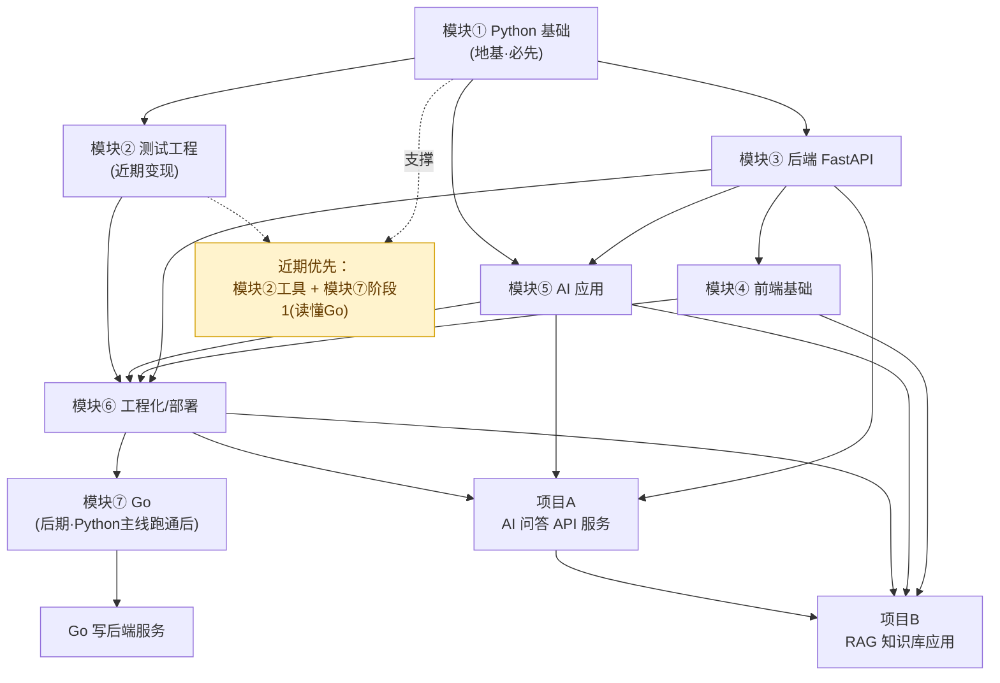

# Requirements Document

## Introduction

这不是一份软件功能需求，而是一份**个人学习路线的 requirements**。目标是把「从测试工程师转型为 AI 全栈工程师」这件事，拆成一组**可验收的能力目标**。

核心思路（借用测试思维）：
- 把每个「学习目标」当作一条**需求**；
- 把「是否达标」写成一条**可验收标准**——每条都要能明确判断"过 / 不过"，而不是模糊的"学会了"；
- 用 EARS 句式和清晰可测的表述来写验收标准，让"合格"这件事有明确边界。

验收对象统一称为 **学习者（Learner）**。绝大多数验收标准采用事件驱动句式：*WHEN 给定[某个真实场景/任务]，THE 学习者 SHALL 能够[产出某个可检查的结果]*。所谓"可检查"，指产出物可以运行、可以被测试、或可以被另一位工程师 review 后判断是否达标。

本文档只覆盖 requirements（做什么、达标标准是什么），不涉及 design（怎么学、用什么资料）和 tasks（具体学习任务拆分）。

---

## Glossary

- **学习者（Learner）**：本路线的执行主体，即你本人（测试工程师背景）。所有验收标准都在描述学习者应具备的可验证能力。
- **可运行代码（Runnable_Code）**：无需修改即可在指定环境（Python 3.12+ / Go 1.22+）直接执行并得到预期结果的代码。
- **可测试（Testable）**：代码结构允许为其编写自动化测试（函数职责单一、依赖可注入、副作用可隔离）。
- **可维护（Maintainable）**：具备清晰分层、命名规范、类型注解与必要注释，另一位工程师能在不询问作者的情况下读懂并修改。
- **达标产出物（Deliverable）**：用于验收某项能力的具体交付物，如一个脚本、一个 API、一份测试报告、一个可部署的项目。
- **读懂 Go 代码（Read_Go）**：能准确说出一段项目 Go 代码"做了什么、数据怎么流动、并发/错误如何处理"，而不要求能从零编写。
- **RAG**：检索增强生成（Retrieval-Augmented Generation），先检索相关资料再交给大模型生成答案的应用模式。
- **Agent**：能根据目标自主决定调用哪些工具、并串联多步操作来完成任务的 LLM 应用。
- **近期优先项（Near_Term）**：3 个月内、直接服务当前测试工作的目标——写测试脚本/工具、读懂项目 Go 代码。
- **模块（Module）**：本路线的一级学习单元（共 8 个），每个模块包含若干章节要点。
- **章节要点（Chapter）**：模块内的二级学习单元，对应本文档中各模块下的二级标题。

---

## Capability Gap Analysis（能力差距分析：现状 vs 目标）

下表把"现状"和"目标能力"并排列出，中间给出**关键差距**——差距即本路线要填平的东西。这一节的作用是：让每个模块的存在都有据可依，避免学"用不上的东西"。

| 领域 | 现状 | 目标能力 | 关键差距 |
|------|------|----------|----------|
| Python 语法 | 会基本语法 | 熟练使用语法写出结构化代码 | 从"会写几行"到"会组织一个项目" |
| Python 工程能力 | 没独立写过项目 | 结构清晰、可测试、可维护的项目 | 项目结构、分层、模块化、类型注解全缺 |
| 设计能力 | 基本空白 | 会做分层、抽象、解耦，能讲清为什么这样分层/抽象，并在项目中落地 | 缺少"为什么这样设计"的判断力 |
| 测试工程 | 有测试思维（优势） | 会 pytest 进阶 / mock / 接口自动化 / 框架设计 | 有思维但缺工具链落地与工具开发能力 |
| 后端 | 空白 | FastAPI + 数据库 + 认证 + 异步 | 整个后端技术栈从零 |
| 前端 | 空白 | 基础页面 + 框架 + 调接口 | 整个前端技术栈从零 |
| AI 应用 | 空白 | LLM / RAG / Agent / 流式 | AI 应用全栈从零 |
| 工程化/部署 | 空白 | Git 进阶 / Docker / CI-CD / 部署 | 交付与上线全链路从零 |
| Go | 完全不会 | 近期读懂、后期能写后端服务 | 语法、并发模型、工程化全缺 |
| 完整项目经验 | 无 | 独立完成 2 个 AI 全栈项目 | 缺少端到端串联经验 |

**优势利用**：测试思维（质量意识、边界思维、用例设计）是学习者的存量优势。本路线要求在每个模块中**主动复用**这一优势——例如学 Python 就配套写测试、学后端就做接口自动化、学任何功能都先想边界条件。

---

## Requirements

> 说明：Requirement 1~11 是**顶层能力目标**（对应近期需求与长期目标），每条给出可验收标准。Requirement 12~19 是**各模块的章节要点 + 每章验收标准**。Requirement 20 是**学习顺序与节奏**。Requirement 21 是**非功能要求**。

### Requirement 1: 写出结构清晰、可测试、可维护的 Python 项目

**User Story:** 作为想转型的测试工程师，我想能独立写出结构良好的 Python 项目，以便让我的代码经得起 review 和长期维护。

#### Acceptance Criteria

1. WHEN 需要新建一个 Python 项目，THE 学习者 SHALL 能够创建包含依赖管理（如 `pyproject.toml`/虚拟环境）、源码目录、测试目录的标准结构。
2. WHEN 编写一个功能模块，THE 学习者 SHALL 能够按"职责单一"原则拆分函数与类，且每个公开函数带类型注解。
3. WHEN 项目完成，THE 学习者 SHALL 能够为核心逻辑编写自动化测试，且测试可通过 `pytest` 一次性运行通过。
4. WHERE 项目涉及外部依赖（文件、网络、时间），THE 学习者 SHALL 能够通过参数注入或 mock 使核心逻辑可在无外部依赖下被测试。
5. IF 另一位工程师 review 代码，THEN THE 学习者 SHALL 能够在不额外口头解释的情况下，让对方读懂模块职责与数据流向。

### Requirement 2: 能独立写测试脚本/工具（近期优先项）

**User Story:** 作为测试工程师，我想能自己写测试脚本和小工具，以便立刻提升当前工作效率。

#### Acceptance Criteria

1. WHEN 面对一个重复性测试任务（如批量构造数据、批量调接口），THE 学习者 SHALL 能够在无人协助下编写出可运行脚本完成该任务。
2. WHEN 脚本需要处理输入异常（空值、格式错误、超时），THE 学习者 SHALL 能够加入错误处理并输出清晰的日志。
3. WHEN 脚本交付使用，THE 学习者 SHALL 能够提供命令行参数或配置项，使他人无需改代码即可复用。
4. THE 学习者 SHALL 能够在 3 个月内产出至少 1 个已应用于实际测试工作的脚本/工具作为达标产出物。

### Requirement 3: 能读懂项目中的 Go 代码并能改简单逻辑（近期优先项）

**User Story:** 作为需要接触 Go 项目的测试工程师，我想能读懂项目里的 Go 代码，以便定位问题、配合开发、必要时改简单逻辑。

#### Acceptance Criteria

1. WHEN 给定一段项目中的 Go 函数，THE 学习者 SHALL 能够用中文准确说明该函数的输入、输出、以及主要执行流程。
2. WHEN 一段 Go 代码使用了 goroutine、channel 或 error 返回，THE 学习者 SHALL 能够解释其并发行为与错误处理路径。
3. WHEN 需求是修改一处简单逻辑（如调整判断条件、增加一个字段、改一行日志），THE 学习者 SHALL 能够完成修改且代码可编译通过。
4. THE 学习者 SHALL 不被要求在近期从零独立编写完整 Go 服务（该能力属于后期目标，见 Requirement 10）。

### Requirement 4: 用 FastAPI 开发后端 API（含数据库）

**User Story:** 作为转型者，我想能用 FastAPI 开发带数据库的后端 API，以便具备后端服务的独立开发能力。

#### Acceptance Criteria

1. WHEN 给定一组接口需求，THE 学习者 SHALL 能够用 FastAPI 实现对应路由，并用 Pydantic 定义请求/响应模型。
2. WHEN 接口需要持久化数据，THE 学习者 SHALL 能够通过 ORM 完成增删改查并连接到真实数据库。
3. WHERE 接口需要保护，THE 学习者 SHALL 能够实现基础认证（如 token 校验）并拒绝未授权请求。
4. WHEN 接口涉及耗时操作，THE 学习者 SHALL 能够用异步方式实现且不阻塞其他请求。
5. THE 学习者 SHALL 能够为已实现的接口编写自动化接口测试并全部通过。

### Requirement 5: 做基础前端并对接后端

**User Story:** 作为全栈方向的学习者，我想能做基础前端页面并对接后端接口，以便独立完成"能看能用"的应用。

#### Acceptance Criteria

1. WHEN 需要展示一个数据列表页，THE 学习者 SHALL 能够用 HTML/CSS 与一个前端框架实现页面渲染。
2. WHEN 页面需要数据，THE 学习者 SHALL 能够调用后端 API 并将返回数据正确显示。
3. IF 接口返回错误或加载中，THEN THE 学习者 SHALL 能够在页面上给出对应的状态提示。
4. THE 学习者 SHALL 能够将前端项目打包为可部署的静态产物。

### Requirement 6: 开发 AI 应用（LLM、RAG、简单 Agent）

**User Story:** 作为目标是 AI 全栈的学习者，我想能开发 LLM/RAG/Agent 类应用，以便具备 AI 应用的核心开发能力。

#### Acceptance Criteria

1. WHEN 需要调用大模型，THE 学习者 SHALL 能够通过 LLM API 完成一次问答请求并处理返回结果。
2. WHEN 用户提问需要结合外部知识，THE 学习者 SHALL 能够构建一个 RAG 流程：文档切分 → 向量化 → 检索 → 交给 LLM 生成答案。
3. WHEN 任务需要多步操作，THE 学习者 SHALL 能够实现一个简单 Agent，让 LLM 决定调用哪个工具并串联结果。
4. WHERE 前端需要实时反馈，THE 学习者 SHALL 能够实现流式输出。
5. THE 学习者 SHALL 能够设计一个 AI 应用的整体架构（分层、模块职责、数据流）并说明设计取舍。

### Requirement 7: 用 Docker 部署上线

**User Story:** 作为想独立交付的学习者，我想能用 Docker 把应用部署上线，以便完成从开发到可访问的完整闭环。

#### Acceptance Criteria

1. WHEN 一个项目开发完成，THE 学习者 SHALL 能够为其编写 Dockerfile 并成功构建镜像。
2. WHEN 应用有多个服务（如 API + 数据库），THE 学习者 SHALL 能够用 Docker Compose 编排并一键启动。
3. WHEN 部署到云服务器，THE 学习者 SHALL 能够让应用通过公网地址被访问。
4. WHERE 需要观测运行状态，THE 学习者 SHALL 能够查看应用日志并定位一次线上错误。

### Requirement 8: 具备工程化交付能力

**User Story:** 作为要独立做项目的学习者，我想掌握工程化协作与交付流程，以便项目可持续维护而非一次性脚本。

#### Acceptance Criteria

1. WHEN 多人协作或多分支开发，THE 学习者 SHALL 能够使用 Git 分支、合并、解决冲突。
2. WHEN 代码提交，THE 学习者 SHALL 能够通过 CI 自动运行测试。
3. THE 学习者 SHALL 能够按规范组织项目结构，使项目具备可维护性。

### Requirement 9: 能读懂 Go 项目代码（阶段1，与 Requirement 3 对齐）

**User Story:** 作为近期需接手 Go 项目的学习者，我想先达到"读懂"级别，以便不阻塞当前工作。

#### Acceptance Criteria

1. THE 学习者 SHALL 能够识别 Go 的基本语法结构（包、函数、结构体、接口、错误返回）。
2. WHEN 给定项目中常见的 Go 模式（如 handler、middleware、并发处理），THE 学习者 SHALL 能够说明其作用。
3. 本需求为 Requirement 3 的知识支撑，达标标准以 Requirement 3 的验收为准。

### Requirement 10: 后期能用 Go 开发后端服务

**User Story:** 作为完成 Python 主线后的学习者，我想系统学 Go 并能写后端服务，以便具备第二语言的后端开发能力。

#### Acceptance Criteria

1. WHERE Python 主线（模块①~⑥）已达标，THE 学习者 SHALL 开始系统学习 Go。
2. WHEN 系统学习完成，THE 学习者 SHALL 能够用 Go 独立实现一个提供 HTTP 接口的后端服务。
3. WHEN 服务涉及并发，THE 学习者 SHALL 能够正确使用 goroutine 与 channel 且无明显数据竞争。

### Requirement 11: 独立完成 2 个完整 AI 全栈项目

**User Story:** 作为要具备"独立项目开发能力"的学习者，我想完成 2 个端到端项目，以便把所有模块能力串联并验证。

#### Acceptance Criteria

1. THE 学习者 SHALL 独立完成项目 A（中期）：一个 AI 问答 API 服务，包含后端 API + LLM 调用 + 可部署。
2. THE 学习者 SHALL 独立完成项目 B（后期）：一个带前端的 RAG 知识库应用，包含前端 + 后端 + RAG + 部署。
3. WHEN 项目交付，THE 学习者 SHALL 能够提供可运行的代码、自动化测试、以及可通过公网访问的部署地址。
4. IF 项目被他人 review，THEN THE 学习者 SHALL 能够清晰讲解整体架构与关键设计取舍。

---

## 模块① Python 编程基础（章节要点 + 验收标准）

> 模块目标：**写好代码 + 会设计**。这是整条路线的地基，练习场景全部取自测试工作（数据处理、接口、日志、工具）。

### 环境与项目结构
- 要点：虚拟环境、依赖管理、标准项目目录布局。
- 验收：WHEN 从零开始，THE 学习者 SHALL 能够搭建一个带虚拟环境与规范目录的可运行项目骨架。

### 数据类型与控制流
- 要点：常用数据类型、条件、循环、推导式。
- 验收：WHEN 给定一个数据处理任务，THE 学习者 SHALL 能够选用合适的数据结构并用控制流实现。

### 函数
- 要点：参数、返回值、作用域、职责单一。
- 验收：WHEN 逻辑重复出现，THE 学习者 SHALL 能够将其抽取为职责单一、可复用的函数。

### 模块与包
- 要点：import 机制、模块拆分、包的组织。
- 验收：WHEN 代码超过单文件规模，THE 学习者 SHALL 能够按职责拆分为多个模块并正确导入。

### 面向对象
- 要点：类、封装、继承、组合、何时用 OOP。
- 验收：WHEN 需要管理一组相关状态与行为，THE 学习者 SHALL 能够用类建模并说明为何用类而非函数。

### 异常与日志
- 要点：异常处理、自定义异常、logging 使用。
- 验收：IF 程序遇到异常输入，THEN THE 学习者 SHALL 能够捕获处理并输出可定位问题的日志。

### 文件与数据处理
- 要点：文本/CSV/JSON 读写、常见数据清洗。
- 验收：WHEN 给定一个数据文件，THE 学习者 SHALL 能够读取、转换并输出目标格式。

### 标准库
- 要点：常用标准库（os/pathlib/datetime/collections/itertools 等）。
- 验收：WHEN 遇到常见任务，THE 学习者 SHALL 能够优先选用标准库而非重复造轮子。

### 类型注解与代码规范
- 要点：type hints、格式化/lint 工具、命名规范。
- 验收：THE 学习者 SHALL 能够为公开函数补全类型注解并使代码通过 lint 检查。

### 设计思维（分层/抽象/解耦）
- 要点：分层思想、抽象边界、依赖解耦。
- 验收：WHEN 面对一个中等复杂需求，THE 学习者 SHALL 能够给出分层方案并说明每层职责与解耦点。

### 设计模式在测试中的应用
- 要点：工厂/策略/装饰器等在测试代码中的落地。
- 验收：WHEN 测试代码出现重复或难扩展，THE 学习者 SHALL 能够用合适的设计模式重构并说明选择理由。

---

## 模块② 测试工程专项（章节要点 + 验收标准）

> 模块目标：**服务近期工作**，保持精简。这是把学习者存量优势（测试思维）快速变现的模块。

### pytest 进阶
- 要点：fixture、参数化、conftest、标记。
- 验收：WHEN 有一组相似用例，THE 学习者 SHALL 能够用参数化与 fixture 消除重复。

### mock
- 要点：mock/patch、隔离外部依赖。
- 验收：WHEN 被测逻辑依赖外部服务，THE 学习者 SHALL 能够用 mock 隔离并使测试稳定可重复。

### 接口自动化
- 要点：HTTP 请求、断言、用例组织。
- 验收：WHEN 给定一组接口，THE 学习者 SHALL 能够编写覆盖正常与边界场景的自动化接口用例。

### 测试报告与 CI
- 要点：报告生成、在 CI 中运行测试。
- 验收：WHEN 测试完成，THE 学习者 SHALL 能够生成可读报告并让测试在 CI 中自动运行。

### 工具开发实战
- 要点：把测试需求做成可复用工具。
- 验收：THE 学习者 SHALL 能够交付至少 1 个应用于实际工作的测试工具（与 Requirement 2 对齐）。

### 测试框架设计
- 要点：分层框架、配置、可扩展性。
- 验收：WHEN 用例规模增长，THE 学习者 SHALL 能够设计出可扩展的测试框架结构并说明分层理由。

---

## 模块③ 后端开发（章节要点 + 验收标准）

> 模块目标：具备 FastAPI 后端独立开发能力（对应 Requirement 4）。

### FastAPI 入门
- 要点：ASGI 与应用实例、路由装饰器、自动交互文档（Swagger/OpenAPI）。
- 验收：THE 学习者 SHALL 能够启动一个 FastAPI 应用并访问其自动生成的接口文档。

### 路由
- 要点：路径操作、HTTP 方法、路径/查询参数、请求体。
- 验收：WHEN 给定接口需求，THE 学习者 SHALL 能够定义路径、方法、路径/查询参数。

### Pydantic
- 要点：模型定义、字段校验、类型转换、请求/响应模型分离。
- 验收：WHEN 接口有输入输出结构，THE 学习者 SHALL 能够用 Pydantic 定义模型并自动校验。

### 依赖注入
- 要点：Depends 机制、共享依赖、数据库会话注入、可测试性。
- 验收：WHEN 多个接口共享逻辑（如数据库会话），THE 学习者 SHALL 能够用依赖注入复用。

### 数据库 ORM
- 要点：SQLAlchemy 建模、会话管理、增删改查、数据库迁移。
- 验收：WHEN 需要持久化，THE 学习者 SHALL 能够用 ORM 完成建模与增删改查。

### 认证
- 要点：token/JWT、密码哈希、依赖式鉴权、拒绝未授权。
- 验收：WHERE 接口需保护，THE 学习者 SHALL 能够实现基础认证并拒绝未授权访问。

### 异步
- 要点：async/await、异步路由、并发不阻塞、何时该用异步。
- 验收：WHEN 存在耗时操作，THE 学习者 SHALL 能够用异步实现且不阻塞其他请求。

### API 设计规范
- 要点：RESTful 命名、状态码、统一错误结构、接口版本。
- 验收：WHEN 设计一组接口，THE 学习者 SHALL 能够遵循一致的命名、状态码与错误结构约定。

### 部署准备
- 要点：配置与环境变量分离、uvicorn/gunicorn 启动、容器化衔接。
- 验收：THE 学习者 SHALL 能够将后端配置为可容器化部署（与模块⑥衔接）。

---

## 模块④ 前端基础（章节要点 + 验收标准）

> 模块目标：能做"能看能用"的前端并对接后端（对应 Requirement 5）。

### HTML/CSS
- 要点：语义化标签、盒模型、Flex/Grid 布局、响应式基础。
- 验收：THE 学习者 SHALL 能够实现一个结构清晰、样式基本可用的页面。

### JS 基础
- 要点：变量与函数、DOM 操作、事件处理、异步（fetch/Promise）。
- 验收：WHEN 页面需要交互，THE 学习者 SHALL 能够用 JavaScript 处理事件与数据。

### 一个框架
- 要点：组件、状态管理、数据驱动视图（Vue 或 React 二选一）。
- 验收：THE 学习者 SHALL 能够用一个前端框架实现组件化页面（框架二选一即可，不铺开）。

### 调接口
- 要点：fetch/axios、异步请求、跨域（CORS）、数据绑定渲染。
- 验收：WHEN 页面需要数据，THE 学习者 SHALL 能够调用后端 API 并渲染结果。

### 组件化
- 要点：组件拆分、props 与事件通信、复用与组合。
- 验收：WHEN 页面出现重复 UI，THE 学习者 SHALL 能够抽取为可复用组件。

### 打包
- 要点：构建工具（Vite）、打包产物、静态资源部署。
- 验收：THE 学习者 SHALL 能够将前端打包为可部署静态产物。

---

## 模块⑤ AI 应用开发（章节要点 + 验收标准）

> 模块目标：具备 LLM/RAG/Agent 应用开发能力（对应 Requirement 6）。

### LLM API 调用
- 要点：客户端调用、messages 结构、参数（temperature/max_tokens）、错误与重试。
- 验收：THE 学习者 SHALL 能够完成一次 LLM 请求并正确处理返回与错误。

### Prompt 工程
- 要点：角色设定、few-shot 示例、结构化输出、迭代调优。
- 验收：WHEN 输出不符合预期，THE 学习者 SHALL 能够通过调整 Prompt 改善结果并说明改动理由。

### 向量与 Embedding
- 要点：文本向量化、相似度计算（余弦）、向量库基础。
- 验收：THE 学习者 SHALL 能够将文本转为向量并计算相似度。

### RAG
- 要点：文档切分、向量检索、上下文拼接、交给 LLM 生成。
- 验收：WHEN 问题需结合外部知识，THE 学习者 SHALL 能够实现"切分→向量化→检索→生成"完整 RAG 流程。

### Agent 与工具调用
- 要点：function calling、工具定义、多步决策、结果串联。
- 验收：WHEN 任务需多步，THE 学习者 SHALL 能够实现让 LLM 选择并调用工具的简单 Agent。

### 流式输出
- 要点：SSE/流式响应、逐 token 返回、前端增量渲染。
- 验收：WHERE 需要实时反馈，THE 学习者 SHALL 能够实现流式返回。

### AI 应用架构
- 要点：分层（接入/编排/模型/数据）、模块职责、数据流、成本与延迟取舍。
- 验收：THE 学习者 SHALL 能够设计一个 AI 应用的分层架构并说明设计取舍。

---

## 模块⑥ 工程化（章节要点 + 验收标准）

> 模块目标：具备交付与上线能力（对应 Requirement 7、8）。

### Git 进阶
- 要点：分支模型、merge/rebase、冲突解决、PR 协作流程。
- 验收：WHEN 多分支协作，THE 学习者 SHALL 能够分支、合并并解决冲突。

### 项目结构规范
- 要点：分层目录、配置管理、依赖锁定、README 与文档。
- 验收：THE 学习者 SHALL 能够按规范组织一个可维护的项目结构。

### 测试
- 要点：自动化测试纳入流程、覆盖率、测试作为交付门禁。
- 验收：THE 学习者 SHALL 能够在工程化流程中让自动化测试成为交付的一环。

### Docker
- 要点：镜像与容器、Dockerfile、分层缓存、Compose 编排。
- 验收：THE 学习者 SHALL 能够编写 Dockerfile 并构建可运行镜像。

### CI-CD
- 要点：流水线、自动测试、自动构建与部署雏形。
- 验收：WHEN 代码提交，THE 学习者 SHALL 能够触发 CI 自动运行测试（并具备自动部署雏形）。

### 云服务器部署
- 要点：服务器基础、反向代理（Nginx）、公网访问、HTTPS。
- 验收：THE 学习者 SHALL 能够将应用部署到云服务器并通过公网访问。

### 监控与日志
- 要点：结构化日志、日志查看、错误定位、基础监控。
- 验收：WHERE 需观测，THE 学习者 SHALL 能够查看日志并定位一次线上问题。

---

## 模块⑦ Go 语言（章节要点 + 验收标准）

> 模块目标：**后期启动**，须在 Python 主线（模块①~⑥）跑通后进行。分三阶段，前期只求"读懂"以服务近期工作。

### 阶段1：读懂项目 Go 代码
- 要点：语法速览、并发基础（goroutine/channel）、常见项目模式。
- 验收：WHEN 给定项目 Go 代码，THE 学习者 SHALL 能够解释其功能、数据流、并发与错误处理（对齐 Requirement 3、9）。

### 阶段2：系统学 Go
- 要点：语法体系、并发模型、工程化（模块、测试、依赖）。
- 验收：THE 学习者 SHALL 能够独立写出带测试的 Go 小程序。

### 阶段3：用 Go 写一个后端服务
- 要点：HTTP 服务、并发处理、工程结构。
- 验收：THE 学习者 SHALL 能够用 Go 实现一个提供 HTTP 接口的后端服务（对齐 Requirement 10）。

---

## 模块⑧ 项目实战（验收标准）

> 模块目标：端到端串联所有能力（对应 Requirement 11）。

### 项目 A（中期）：AI 问答 API 服务
- 验收：THE 学习者 SHALL 独立交付一个后端 API + LLM 调用的问答服务，具备自动化测试且可容器化部署。

### 项目 B（后期）：带前端的 RAG 知识库应用
- 验收：THE 学习者 SHALL 独立交付一个含前端 + 后端 + RAG + 部署的完整应用，可通过公网访问。

---

## Requirement 20：模块依赖关系与学习顺序

**User Story:** 作为需要合理安排学习顺序的学习者，我想清楚各模块的先后依赖，以便不走回头路、也不在没打好地基时硬啃后面的内容。

#### 依赖关系图（Mermaid）

#### Acceptance Criteria

1. THE 学习者 SHALL 以模块① Python 基础作为一切后续模块的前置，不跳过。
2. WHERE 目标是近期变现，THE 学习者 SHALL 在模块①具备基本能力后，优先推进模块②（测试工具）与模块⑦阶段1（读懂 Go）。
3. THE 学习者 SHALL 在模块③后端达标后再进入模块④前端与模块⑤ AI 应用。
4. THE 学习者 SHALL 在完成模块③⑤⑥后再启动项目 A，在完成模块④及项目 A 后再启动项目 B。
5. THE 学习者 SHALL 在 Python 主线（模块①~⑥）跑通后再系统学习模块⑦ Go（读懂阶段除外，读懂阶段可与近期需求并行）。

---

## Requirement 21：学习节奏建议（3~6 个月）

**User Story:** 作为时间有限的在职学习者，我想有一个务实的节奏建议，以便边工作边推进、且尽早让所学服务当前工作。

#### 阶段节奏（建议，非硬性排期）

| 阶段 | 时间窗 | 主攻模块 | 里程碑（可验收） |
|------|--------|----------|------------------|
| 近期 | 第 1~2 月 | 模块①（重点）+ 模块②起步 + 模块⑦阶段1 | 产出 1 个实际可用测试脚本/工具；能读懂一段项目 Go 代码 |
| 中期 | 第 3~4 月 | 模块③后端 + 模块⑤ AI 应用起步 | 完成一个带数据库的 FastAPI 服务；完成一次 RAG 流程 demo |
| 中期末 | 第 4 月 | 模块⑥工程化 + 项目 A | 交付项目 A（AI 问答 API，可部署） |
| 后期 | 第 5~6 月 | 模块④前端 + 项目 B | 交付项目 B（带前端 RAG 知识库，公网可访问） |
| 延伸 | 6 月后 | 模块⑦阶段2/3（系统学 Go） | 用 Go 写一个后端服务 |

#### Acceptance Criteria

1. THE 学习者 SHALL 在第 1~2 月内完成两项近期优先里程碑：产出可用测试脚本/工具（Requirement 2）、能读懂项目 Go 代码（Requirement 3）。
2. WHILE 处于近期阶段，THE 学习者 SHALL 优先保证服务当前工作的产出，而非追求覆盖全部模块。
3. THE 学习者 SHALL 以"每阶段产出一个可验收里程碑"作为进度判据，而非以"学了多少章"作为判据。
4. IF 某阶段里程碑未达成，THEN THE 学习者 SHALL 优先补齐该里程碑再进入下一阶段。
5. THE 学习者 SHALL 在每完成一个知识点后，于 `codelearn/` 对应主题目录留下简短 `NOTES.md`（学了什么、关键要点、遗留疑问）。

---

## Requirement 22：非功能要求

**User Story:** 作为追求"真正会用"的学习者，我想给学习过程设定质量底线，以便学到的东西可运行、贴合目标、且理解到位。

#### Acceptance Criteria

1. THE 学习者 SHALL 确保所有练习代码为可运行代码（Python 3.12+ / Go 1.22+），可直接执行得到预期结果。
2. THE 学习者 SHALL 使所有练习场景贴合"AI 全栈 + 测试 + Go 项目"目标，不投入与目标无关的内容。
3. WHEN 学习一个新知识点，THE 学习者 SHALL 能够说明"为什么这样设计"，而不仅是"怎么写"。
4. THE 学习者 SHALL 在每个模块中主动复用测试思维（质量、边界、用例设计），例如为所学功能配套编写测试。
5. WHERE 涉及取舍，THE 学习者 SHALL 能够列出常见方案的优缺点并说明适用场景。
6. THE 学习者 SHALL 优先动手实践验证（先预测输出、再运行对照），而非只读不练。
