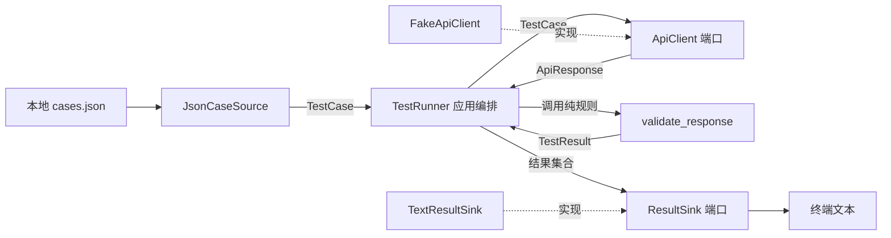
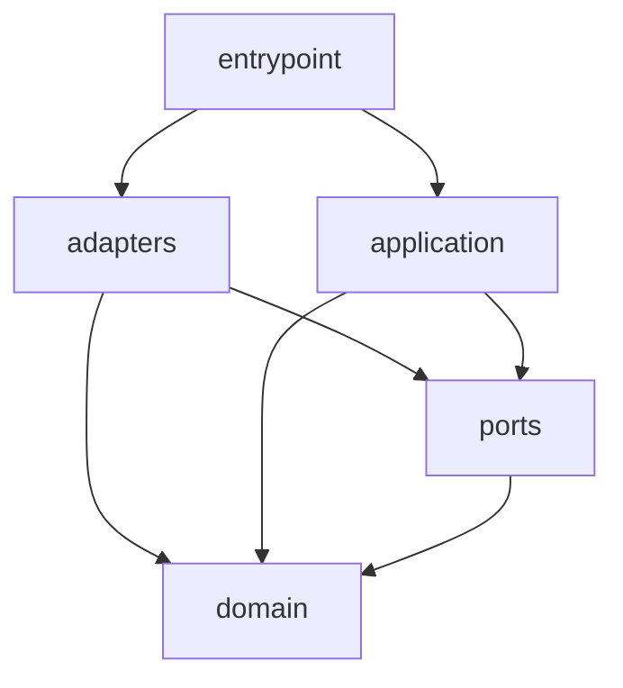

# 1.10 设计思维（分层/抽象/解耦）

> 运行环境：Python 3.12+
>
> 对应模块验收：模块①·设计思维；Req 1.5

**Validates: Requirements 1.4, 1.5**

## 目录
- [1. 场景引入](#1-场景引入)
- [2. 可运行代码示例](#2-可运行代码示例)
- [3. 设计思考](#3-设计思考)
- [4. 常见坑](#4-常见坑)
- [5. 最佳实践](#5-最佳实践)
- [6. 练习题](#6-练习题)
- [7. 小结与自检](#7-小结与自检)

## 1. 场景引入

测试团队最初只想跑 3 条接口用例，于是写了一个函数：读取 JSON、拼环境地址、发送 HTTP 请求、比较状态码、打印结果并写报告。它并非“看不懂”，真正的问题是这些代码因**不同原因变化**，却被绑在同一个位置：

- 测试环境改变，要改地址和网络逻辑；
- 用例改存 CSV 或数据库，要改读取逻辑；
- 校验增加响应字段，要在 I/O 中间插规则；
- 报告改成终端、JSON 或 CI 附件，又要改同一函数；
- 自动化测试若直接调用它，就会读真实文件、发真实网络并产生报告文件。

重构前版本保存在 [`examples/spaghetti_before.txt`](code/10-design-thinking/examples/spaghetti_before.txt)。它可以从上往下读，但文件、网络、规则和输出没有边界；尤其是宽泛 `except Exception` 把不同失败压成同一种结果。新增任何一种变化都可能牵动整条流程。

先思考：如果需求只是“把文本报告替换成 JSON 报告”，状态码比较规则为什么也要重新测试？如果单元测试只想验证 `200 == 200`，为什么必须准备文件和网络？

**一句话直觉：分层把不同变化原因放到不同边界，抽象只保留协作所需的最小契约，解耦让替换外部依赖时核心规则不用跟着改。**

本章不追求复杂架构名词，而是解决 reviewer 最关心的三个问题：每段代码负责什么？数据怎样流动？替换文件、客户端或报告器时需要改哪里？

## 2. 可运行代码示例

完整工程位于 [`code/10-design-thinking/`](code/10-design-thinking/)：

```text
10-design-thinking/
├── pyproject.toml
├── README.md
├── examples/
│   ├── cases.json
│   └── spaghetti_before.txt
├── src/layered_test_runner/
│   ├── __init__.py
│   ├── __main__.py
│   ├── domain.py
│   ├── ports.py
│   ├── application.py
│   └── adapters.py
└── tests/
    ├── test_domain.py
    ├── test_adapters.py
    ├── test_application.py
    └── test_main.py
```

### 2.1 先画职责与依赖，再移动代码

| 边界 | 负责 | 不负责 | 主要变化原因 |
|---|---|---|---|
| `domain` | 用例、响应、结果与纯校验规则 | 文件、HTTP、打印、流程编排 | 业务判定规则变化 |
| `application` | 加载→执行→校验→输出的顺序与异常语义 | JSON 格式、客户端实现、报告格式 | 用例流程变化 |
| `ports` | 应用层协作所需的最小契约 | 具体实现和通用框架 | 替换点的协作方式变化 |
| `adapters` | JSON、内存客户端、文本/内存输出 | 决定业务流程 | 外部技术或格式变化 |
| `entrypoint` | 选择具体实现并完成组装 | 实现校验规则 | 运行环境和配置变化 |

注意：这五项是职责边界，不表示每个小脚本都必须创建五层目录。本例把 `ports` 独立出来，是因为用例源、客户端和输出确实是需要替换和隔离的外部边界。

### 2.2 domain：纯规则不认识外部世界

`domain.py` 只表达稳定数据和状态码规则：

```python
from dataclasses import dataclass


@dataclass(frozen=True, slots=True)
class TestCase:
    case_id: str
    endpoint: str
    expected_status: int


@dataclass(frozen=True, slots=True)
class ApiResponse:
    status_code: int


@dataclass(frozen=True, slots=True)
class TestResult:
    case_id: str
    expected_status: int
    actual_status: int
    passed: bool
    detail: str


def validate_response(test_case: TestCase, response: ApiResponse) -> TestResult:
    """纯函数：同样输入总得到同样输出，不读写外部资源。"""
    passed = response.status_code == test_case.expected_status
    detail = "status matched" if passed else "status mismatch"
    return TestResult(
        case_id=test_case.case_id,
        expected_status=test_case.expected_status,
        actual_status=response.status_code,
        passed=passed,
        detail=detail,
    )
```

测试这段规则只需构造两个对象，不需要 `tmp_path`、网络或捕获终端输出。将规则保持为纯函数，并不是为了“函数式编程”，而是让最关键、最常变的判定得到最快且最稳定的反馈。

### 2.3 ports：抽象协作能力，不抽象所有代码

应用层实际只需要三种能力：取得用例、执行用例、接收结果。`ports.py` 用结构化 `Protocol` 写出最小契约：

```python
from collections.abc import Sequence
from typing import Protocol

from .domain import ApiResponse, TestCase, TestResult


class AdapterError(RuntimeError):
    """适配器无法完成端口约定的操作。"""


class CaseSource(Protocol):
    def load_cases(self) -> Sequence[TestCase]: ...


class ApiClient(Protocol):
    def send(self, test_case: TestCase) -> ApiResponse: ...


class ResultSink(Protocol):
    def save(self, results: Sequence[TestResult]) -> None: ...
```

这里没有设计一个包含 URL、请求头、重试、文件路径和报告模板的“万能接口”。`ApiClient` 只暴露核心流程需要的 `send()`；未来真实 HTTP 客户端可以在内部处理 base URL 和认证，fake 只需按 endpoint 返回预设响应。

`Protocol` 使用结构化类型：实现者只要提供匹配的方法即可，不必继承基类。这样应用层依赖的是**能力**，而不是 `JsonCaseSource` 或某个 HTTP 库的类名。

### 2.4 application：只保留可一眼读懂的数据流

`application.py` 通过构造函数注入三个端口：

```python
class TestRunner:
    def __init__(
        self,
        case_source: CaseSource,
        api_client: ApiClient,
        result_sink: ResultSink,
    ) -> None:
        self._case_source = case_source
        self._api_client = api_client
        self._result_sink = result_sink

    def run(self) -> RunSummary:
        try:
            test_cases = tuple(self._case_source.load_cases())
        except AdapterError as error:
            raise TestRunError("加载测试用例失败") from error

        results: list[TestResult] = []
        for test_case in test_cases:
            try:
                response = self._api_client.send(test_case)
            except AdapterError as error:
                raise TestRunError(f"执行用例失败: {test_case.case_id}") from error
            results.append(validate_response(test_case, response))

        result_snapshot = tuple(results)
        try:
            self._result_sink.save(result_snapshot)
        except AdapterError as error:
            raise TestRunError("输出测试结果失败") from error
        return RunSummary(results=result_snapshot)
```

代码从上到下就是“取用例→执行→校验→输出”。应用层捕获的是端口约定的 `AdapterError`，再转换成当前流程能解释的 `TestRunError`；它不需要知道底层究竟是文件不存在、客户端未配置还是输出设备失败。完整文件还包含不可变 `RunSummary` 及 `total/passed/failed` 统计。

为什么这里使用构造函数注入，而不是在 `run()` 内部创建 `JsonCaseSource()` 和客户端？因为“创建哪个实现”属于入口配置，“按什么顺序协作”才属于应用流程。若应用层自己创建具体对象，类型名虽然分文件了，依赖仍然没有断开。

### 2.5 adapters 与 entrypoint：在边界处理技术细节

`adapters.py` 提供四个务实实现：

- `JsonCaseSource` 读取本地 JSON，校验外部 `object` 后构造 `TestCase`；
- `InMemoryCaseSource` 提供不读文件的用例快照；
- `FakeApiClient` 按 endpoint 返回预设 `ApiResponse`，并记录调用顺序；
- `TextResultSink` 输出文本，`CollectingResultSink` 在内存保存结果。

Fake 的关键实现没有任何网络库：

```python
class FakeApiClient:
    def __init__(self, responses: Mapping[str, ApiResponse]) -> None:
        self._responses = dict(responses)
        self._calls: list[str] = []

    @property
    def calls(self) -> tuple[str, ...]:
        return tuple(self._calls)

    def send(self, test_case: TestCase) -> ApiResponse:
        self._calls.append(test_case.endpoint)
        try:
            return self._responses[test_case.endpoint]
        except KeyError as error:
            raise AdapterError(f"没有预设响应: {test_case.endpoint}") from error
```

入口 `__main__.py` 是唯一知道具体组装方式的位置：

```python
def build_runner(case_path: Path, stream: TextIO) -> TestRunner:
    case_source = JsonCaseSource(case_path)
    api_client = FakeApiClient(
        {
            "/login": ApiResponse(status_code=200),
            "/orders/42": ApiResponse(status_code=500),
            "/health": ApiResponse(status_code=200),
        }
    )
    result_sink = TextResultSink(stream)
    return TestRunner(case_source, api_client, result_sink)
```

以后接真实服务时，新建实现 `ApiClient` 契约的适配器，并在入口替换组装；`TestRunner` 与 `validate_response()` 不需要因 HTTP 库改变而修改。本章故意不实现真实 HTTP，确保示例离线、确定且不会误触测试环境。

### 2.6 先预测输出，再运行验证

运行命令：

```bash
cd codelearn/01-python-basics/code/10-design-thinking
/opt/homebrew/bin/python3.12 -m venv .venv
.venv/bin/python -m pip install "setuptools==75.8.0"
.venv/bin/python -m pip install --no-build-isolation -e ".[dev]"
.venv/bin/python -m layered_test_runner
.venv/bin/python -m pytest --color=no
.venv/bin/python -m mypy src tests
.venv/bin/python -m ruff check .
.venv/bin/python -m ruff format --check .
```

先预测：3 条用例的预期都是 200，fake 为 `/orders/42` 返回 500，最终通过和失败各有几条？预期输出：

```text
RUN total=3 passed=2 failed=1
PASS login-001 expected=200 actual=200
FAIL order-002 expected=200 actual=500
PASS health-003 expected=200 actual=200
```

测试不只断言最终数字，还验证编排事件严格为 `source.load → client.send → sink.save`，在网络连接函数被替换成“调用即失败”时 fake 仍能运行，以及更换用例源/结果输出无需修改核心代码。

## 3. 设计思考

### 3.1 数据流与两种方向不要混为一谈



上图主要是**运行时数据流/调用方向**：入口创建对象后，`TestRunner` 调用 source、client、规则和 sink，数据在对象之间移动。

源码依赖方向则不同：



核心原则是箭头朝稳定核心：`domain` 不导入 application、文件或客户端；`application` 不导入 `JsonCaseSource` 和 `TextResultSink`；具体适配器依赖端口和领域模型。运行时应用层会“调用适配器对象”，但源码只认识其 `Protocol`。**调用谁**和**import 谁的具体类**不是一回事。

### 3.2 依赖注入为何提高测试性

依赖注入不是框架专属功能，本例只是把对象从外部作为构造函数参数传入。收益来自控制权变化：

1. 入口决定本次使用 JSON 还是内存用例源；
2. 测试决定使用 fake 客户端，不发真实网络；
3. 测试使用 collecting sink，不写文件、不解析终端；
4. 应用层只验证流程和规则，对外部速度、账号、网络波动不敏感。

这种测试不是“为了通过而模拟结果”。fake 是端口的一个确定实现，验证真实 `TestRunner`、真实领域规则和真实数据流；真实 HTTP 适配器未来应另写边界测试。测试金字塔中的不同层各负其责，不应要求一个单元测试同时证明第三方服务在线。

### 3.3 抽象的时机与粒度

抽象不是把每个函数都包进接口。先问两个问题：

- 这个依赖是否有独立变化原因，例如文件格式、HTTP 库、报告形式？
- 测试是否需要替换它，才能稳定验证核心规则？

两者都否时，普通函数通常足够。`validate_response()` 只有一个清楚实现，所以保持函数；没有创建 `ValidatorProtocol`。客户端即使当前只有 fake，也代表真实网络边界，是明确的测试替换点，因此 `ApiClient` 有价值。

最小契约也限制耦合面：若 `ApiClient` 返回第三方库的完整 response，domain 会逐渐读取库特有属性；本例只把核心需要的 `status_code` 转为自己的 `ApiResponse`。代价是适配器要做一次转换，收益是外部库无法蔓延到核心。

### 3.4 三种组织方式如何选择

| 方案 | 优点 | 代价 | 适用场景 |
|---|---|---|---|
| 单文件分段脚本 | 开始最快、导航成本最低 | I/O 与规则易缠绕，替换和独立测试困难 | 一次性、低风险、几十行且不会扩展 |
| 简单模块拆分 | 按职责分文件，阅读与测试明显改善 | 若模块直接创建具体依赖，替换仍困难 | 规则稳定、外部依赖少的小工具 |
| 协议 + 适配器 + 注入 | 替换边界清楚，核心测试快，依赖方向可控 | 文件与概念更多，需要维护契约 | 多种数据源/报告器、网络/时间等外部依赖、中等复杂流程 |

本例选择第三种，不是因为它永远最好，而是需求明确包含三个变化点。若脚本永远只把一个 CSV 转成固定 JSON，简单模块拆分可能更经济。设计的目标是让变化成本与当前风险匹配，而不是让目录看起来像大型系统。

### 3.5 reviewer 如何无需口头解释理解系统

一个可 review 的分层方案应让代码结构和名称回答：

- **职责**：domain 判定，application 编排，adapter 转换外部技术；
- **数据流**：`TestCase → ApiResponse → TestResult`，入口只组装；
- **解耦点**：`CaseSource`、`ApiClient`、`ResultSink`；
- **错误边界**：adapter 抛 `AdapterError`，application 转成带流程阶段的 `TestRunError`；
- **替换证据**：测试使用另一 source/sink 和 fake client，核心文件没有条件分支判断具体类型。

README、类型注解、Mermaid 图和聚焦测试共同形成证据。设计说明不应只写“采用分层架构”，因为这个标签没有告诉 reviewer 为什么如此拆分。

## 4. 常见坑

| 坑 | 后果 | 根本原因 |
|---|---|---|
| 只把大函数剪贴到多个文件 | 文件变多，具体依赖仍互相创建，改动继续扩散 | 把物理拆分误当作依赖解耦 |
| domain 导入 JSON、requests 或 print | 纯规则必须依赖外部环境才能测试 | 没把外部数据转换留在边界 |
| application 内部 `JsonCaseSource(...)` | 测试无法替换来源，入口配置混入流程 | 对象创建权放错层 |
| 每个函数都定义一个 Protocol | 概念和文件爆炸，阅读成本超过收益 | 为抽象而抽象 |
| 做“万能客户端”接口 | 核心知道 headers、session、重试等无关细节 | 契约按具体实现而非协作需求设计 |
| 一个接口当前只有一个实现就机械抽象 | 维护成本增加，却没有变化点或测试收益 | 用实现数量代替变化风险判断 |
| 直接让核心使用第三方 response | 更换 HTTP 库会修改规则和测试 | 外部类型穿透适配边界 |
| 用 fake 后不再测真实适配器 | 核心稳定，但文件/HTTP 转换错误无法发现 | 混淆核心测试与边界测试职责 |
| 捕获所有 `Exception` 后继续 | 编程错误也被伪装为用例失败 | 没定义可恢复的异常边界 |
| 层之间双向 import | 循环依赖，职责归属模糊 | 没规定源码依赖方向 |
| 目录越多越“专业” | 小需求导航困难、修改要跨大量文件 | 忘记设计是成本取舍 |

## 5. 最佳实践

1. **先按变化原因写职责表**：明确“负责/不负责”，再决定是否拆文件，不从目录模板反推设计。
2. **让核心使用自己的稳定数据**：外部 JSON 和第三方 response 在 adapter 边界校验、转换，domain 只接收 `TestCase` 与 `ApiResponse`。
3. **应用层只保留业务流程语言**：`load → send → validate → save` 应能从 `run()` 直接读出，技术细节下沉到 adapter。
4. **只对真实替换点建立最小端口**：文件、网络、时间、数据库、输出通常值得隔离；单一纯规则优先保留普通函数。
5. **在入口组装对象**：依赖注入的关键不是容器或装饰器，而是让使用者不负责创建其具体依赖。
6. **固定依赖方向**：外层可 import 内层；domain 不反向依赖 adapter/application，application 不 import 具体适配器。
7. **分别验证核心与边界**：纯规则测试不碰 I/O；应用测试注入可控实现；adapter 测试验证 JSON 等真实转换；再保留少量入口集成测试。
8. **测试替换能力而非只看覆盖率**：证明另一用例源、另一输出和 fake client 能接入同一个 `TestRunner`，比只执行行数更能说明解耦有效。
9. **规模不足时及时收手**：若模块拆分已经清楚、没有外部替换需求，就不要提前建设插件系统或通用框架。

## 6. 练习题

### 练习 1：画中等需求的分层方案（基础）

**对应验收：模块①·设计思维；Req 1.5**

需求：从 CSV 读取接口用例，按环境选择 base URL，执行后同时生成终端摘要和 JSON 报告。先不写代码，画出 domain、application、ports、adapters、entrypoint 的数据流图；为每层各写一句“负责”和“不负责”，并标出至少 3 个解耦点。

验收问题：reviewer 能否只看图和职责表，指出“新增数据库用例源”和“新增 HTML 报告”分别只需改哪些边界？

### 练习 2：替换报告器（进阶）

**对应验收：模块①·设计思维；Req 1.4、1.5**

实现 `JsonResultSink`，把结果写到注入的 `Path`。不得修改 `domain.py`、`application.py` 或 `ports.py`；只新增 adapter，并在入口更换组装。测试使用 `tmp_path` 回读 JSON，确认失败结果字段完整。

思考：为什么文件路径属于具体 adapter 配置，不应加入 `ResultSink.save()` 的每次调用参数？

### 练习 3：判断“要不要抽象”（挑战）

**对应验收：模块①·设计思维；Req 1.5**

新需求包含三个候选变化：状态码规则以后可能增加、HTTP 客户端需要替换、结果排序永远按 case_id。分别选择普通函数、Protocol 或暂不处理，并从“变化原因、测试替换、理解成本”三个维度解释。没有唯一答案，但不得只写“为了扩展性”。

## 7. 小结与自检

- 分层依据是变化原因：纯规则、流程编排与外部技术不应互相混杂。
- 抽象只表达协作所需的最小能力；明确替换点和测试隔离点才值得建立端口。
- 依赖注入把具体实现的创建权交给入口，使应用层可以注入 fake、内存源和 collecting sink，不读真实文件、不发真实网络。
- 运行时调用方向与源码依赖方向不同；核心可以调用注入对象，但不应 import 具体适配器。
- 分层脚本、简单模块与协议+适配器各有成本；目录多不是质量指标，能清楚解释职责、数据流和取舍才是。

自检问题（可选择跳过）：

1. 如果 `TestRunner.run()` 内部直接创建 `FakeApiClient`，即使它位于另一个模块，为什么仍不算真正解耦？
2. `validate_response()` 为什么没有再抽成 `ValidatorProtocol`？什么新需求出现时，你才会重新考虑？
